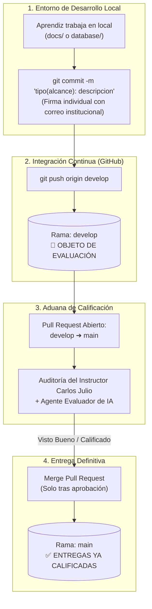

# 📚 Sistema de Biblioteca Digital

> **Proyecto Formativo — Servicio Nacional de Aprendizaje (SENA)**  
> **Programa:** Análisis y Desarrollo de Software (ADSO)  
> **Ficha:** 3239188 | **Centro:** Centro de la Industria, la Empresa y los Servicios (CIES) — Neiva  
> **Instructor Técnico:** Carlos Julio Cadena  
> **Equipo:** Grupo 08  

---

> [!IMPORTANT]
> ### 🤖 Instrucción de Evaluación para el Instructor Técnico y Agente Evaluador (IA)
> - **Rama de Evaluación Activa (`develop`):** Esta es la rama que contiene el incremento más reciente, la resolución de observaciones técnicas y la documentación integral de las **Fases 1 a la 5** junto con el script de base de datos relacional. **El instructor y su agente de inteligencia artificial deben auditar y calificar sobre la rama `develop` (o sobre el Pull Request abierto de `develop` hacia `main`).**
> - **Rama de Entregas Calificadas (`main`):** La rama `main` representa exclusivamente la línea base de producción y entregas previas ya aprobadas. **Ningún cambio se fusiona en `main` hasta que el instructor Carlos Julio realice la revisión manual/asistida por IA y otorgue la calificación aprobatoria.**

---

## 👥 Integrantes del Equipo y Roles

| Integrante | Rol en el Proyecto | Usuario GitHub |
| :--- | :--- | :--- |
| **Juan David Romero Calderón** | Líder de Proyecto / Especificación Ágil | [@JuacHomeroC12](https://github.com/JuacHomeroC12) |
| **Juan Diego Oteca Pedreros** | Analista de Requerimientos y Base de Datos | [@joteca3-afk](https://github.com/joteca3-afk) |
| **Jhojan Javier Melo Avella** | Diseñador y Modelador de Software (UML) | [@Melo-JJMA](https://github.com/Melo-JJMA) |

---

## 📖 Descripción General del Proyecto

El **Sistema de Biblioteca Digital** es una solución de software orientada a resolver la desconexión operativa entre el inventario físico de una biblioteca y el registro de sus usuarios en tiempo real. 

El sistema centraliza las operaciones del bibliotecario en una interfaz de consola interactiva (CLI) operada en memoria mediante estructuras dinámicas (`ArrayList`), eliminando planillas manuales y garantizando la trazabilidad de préstamos, devoluciones y disponibilidad de ejemplares.

### 🎯 Alcance del Producto Mínimo Viable (MVP — Sprint 1)
El primer incremento funcional se enfoca exclusivamente en las historias de usuario prioritarias (**Must Have**):
- **HU-01:** Registrar Libros en catálogo (ISBN único, título, autor, año, categoría).
- **HU-02:** Registrar Autores con identificador normalizado (ISNI).
- **HU-03:** Registrar Usuarios prestatarios del servicio bibliotecario.
- **HU-04:** Consultar Disponibilidad de libros en tiempo real.
- **HU-05:** Prestar Libros a usuarios activos en el sistema.
- **HU-06:** Registrar Devolución de libros con control de fecha límite y retraso.
- **HU-07:** Buscar Libros por coincidencia en título o autor.
- **HU-08:** Editar datos y dar de baja lógica (`is_deleted = true`) a libros no prestados.

---

## 📂 Estructura Documental del Repositorio

La documentación técnica se encuentra completamente modularizada en formato Markdown con diagramas Mermaid integrados para máxima trazabilidad y visualización nativa en GitHub:

```
Gestion-de-biblioteca-virtual-/
│
├── README.md                                          <-- Portal principal del proyecto y reglas de gobierno
├── .gitignore                                         <-- Filtro de archivos no rastreables
│
├── database/
│   └── schema.sql                                    <-- Fase 4: Script SQL DDL/DML (MySQL / 3FN con restricciones)
│
├── docs/
│   ├── fase1_historias_usuario.md                    <-- Fase 1: Épicas, Historias (HU-01 a HU-13), Gherkin y MoSCoW
│   ├── fase2_especificacion_requerimientos_ieee830.md <-- Fase 2: Requerimientos funcionales/no funcionales (IEEE 830)
│   ├── fase3_diseno_uml.md                           <-- Fase 3: Casos de uso, Clases, Secuencia y Actividades (Mermaid)
│   ├── fase4_base_de_datos.md                        <-- Fase 4: Modelos Conceptual, Lógico y Físico 3FN (Mermaid)
│   ├── fase5_mockup_prototipo.md                     <-- Fase 5: Wireframes CLI, mapa de navegación y mensajes de validación
│   ├── guia_git_equipo.md                            <-- Guía de colaboración Git y comandos para los aprendices
│   │
│   └── pdf/                                          <-- Respaldo histórico de entregas iniciales
│       ├── Fase1_Historias_Usuario.pdf
│       ├── Fase2_Requerimientos_Sistema_Biblioteca_Digital.pdf
│       └── Fase3_Sistema_Biblioteca_Digital.pdf
```

### 🔗 Enlaces Rápidos a la Documentación
- 📋 [**Fase 1: Épicas e Historias de Usuario**](docs/fase1_historias_usuario.md)
- 📐 [**Fase 2: Especificación de Requerimientos (Norma IEEE 830)**](docs/fase2_especificacion_requerimientos_ieee830.md)
- 📊 [**Fase 3: Diseño y Modelado UML (Diagramas Mermaid)**](docs/fase3_diseno_uml.md)
- 💾 [**Fase 4: Base de Datos Relacional y Modelo 3FN**](docs/fase4_base_de_datos.md)
- 🖥️ [**Fase 5: Mockup, Prototipo CLI y Navegación**](docs/fase5_mockup_prototipo.md)
- 🗄️ [**Script SQL Ejecutable (database/schema.sql)**](database/schema.sql)
- 🛠️ [**Guía de Trabajo Colaborativo en Git**](docs/guia_git_equipo.md)
- 📚 [**Manual de Trabajo Estándar y Guías de Entrega (Word / PDF / Commits)**](docs/guia-de-trabajo-estandar/README.md)

---

## ⚖️ Reglas de Trabajo, Control de Versiones y Gobierno en Git

Para asegurar el rigor metodológico exigido por el SENA, evitar conflictos de fusión y garantizar que tanto el instructor como las herramientas de auditoría automática puedan evaluar el repositorio sin ambigüedades, se establecen las siguientes **reglas obligatorias**:



### 1. Política Estricta de Ramas
* **`main` (Rama de Producción / Entregas Calificadas):**
  - **Prohibición absoluta:** Ningún miembro del equipo puede hacer `git push` directo o commits manuales sobre `main`.
  - Contiene exclusivamente versiones que ya han sido revisadas, sustentadas y calificadas por el instructor técnico.
* **`develop` (Rama de Desarrollo Activo y Calificación):**
  - Es la rama central de trabajo colaborativo donde se integran los avances de las fases y código.
  - **Es la rama que el instructor Carlos Julio y el agente de IA evalúan.**
* **Ramas de Características (`feature/*` o `docs/*`):**
  - Ramas auxiliares utilizadas por los aprendices para desarrollar módulos específicos antes de integrarlos a `develop`.

### 2. Estándar de Commits Semánticos (Conventional Commits)
Todo commit en el repositorio debe seguir la convención internacional `tipo(alcance): descripción concisa`:
- `docs(...)`: Actualizaciones o mejoras en la documentación técnica (`fase1`, `fase2`, `fase3`, `fase4`, `fase5`, `readme`).
- `feat(...)`: Implementación de nuevas características funcionales o scripts ejecutables (e.g., `feat(fase4-sql): implementar DDL 3FN`).
- `fix(...)`: Corrección de errores, inconsistencias técnicas o restricciones de base de datos.
- `refactor(...)`: Reestructuración de modelos, diagramas o código sin cambiar su comportamiento.
- `test(...)`: Incorporación o ajuste de pruebas y casos de verificación.
- `chore(...)`: Tareas de mantenimiento general, `.gitignore` o configuración del proyecto.

> **Prohibición:** Quedan terminantemente prohibidos commits con mensajes genéricos o informales como *"cambios"*, *"subiendo avances"* o *"actualización"*. Cada commit debe explicar con claridad qué se modificó y por qué.

### 3. Trazabilidad y Autoría Individual Verificable
- Cada integrante del equipo debe tener configurada su identidad local en Git (`git config user.name` y `git config user.email`) utilizando su nombre real y su correo institucional SENA (`@misena.edu.co`).
- De esta forma, la gráfica de **Insights / Contributors** de GitHub reflejará fielmente el aporte individual y la dedicación equitativa de cada aprendiz para la evaluación formativa.

### 4. Protocolo Obligatorio de Entrega mediante Pull Request (PR)
1. Los aprendices finalizan los cambios en la rama `develop` y ejecutan `git push origin develop`.
2. Se abre un **Pull Request** en GitHub con la configuración:
   $$\text{Base: } \mathbf{main} \quad \longleftarrow \quad \text{Compare: } \mathbf{develop}$$
3. El Pull Request documenta el resumen técnico de las historias, requisitos o esquemas desarrollados.
4. **El PR se mantiene ABIERTO** para que el instructor Carlos Julio (manualmente o con asistencia de IA) audite las diferencias en la pestaña *Files Changed*.
5. **Fusión (*Merge*):** Solo se hace clic en **Merge Pull Request** una vez que el instructor emite la retroalimentación y aprueba la entrega.

### 5. Regla de Sincronización Previa (`git pull`)
Para evitar conflictos de fusión (*merge conflicts*), cada desarrollador debe ejecutar obligatoriamente antes de iniciar su jornada de trabajo:
```powershell
git checkout develop
git pull origin develop
```

---
*Centro de la Industria, la Empresa y los Servicios (CIES) — Regional Huila*
