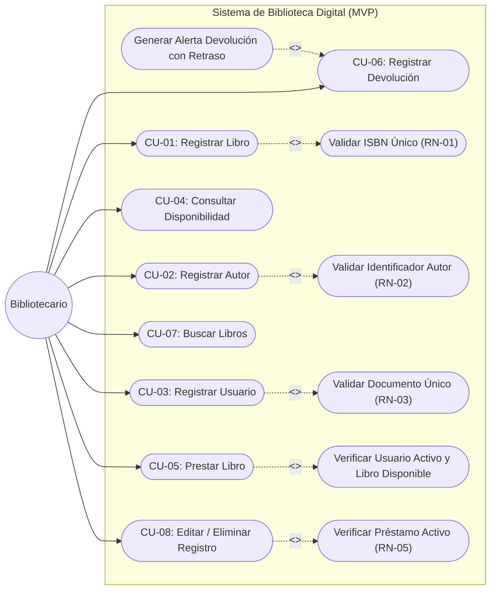
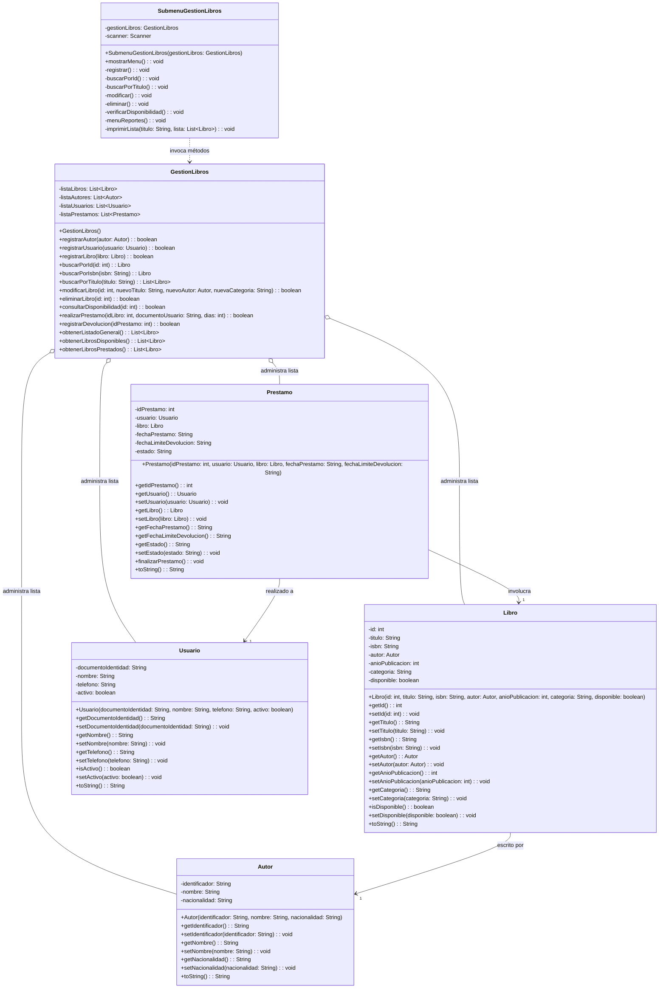
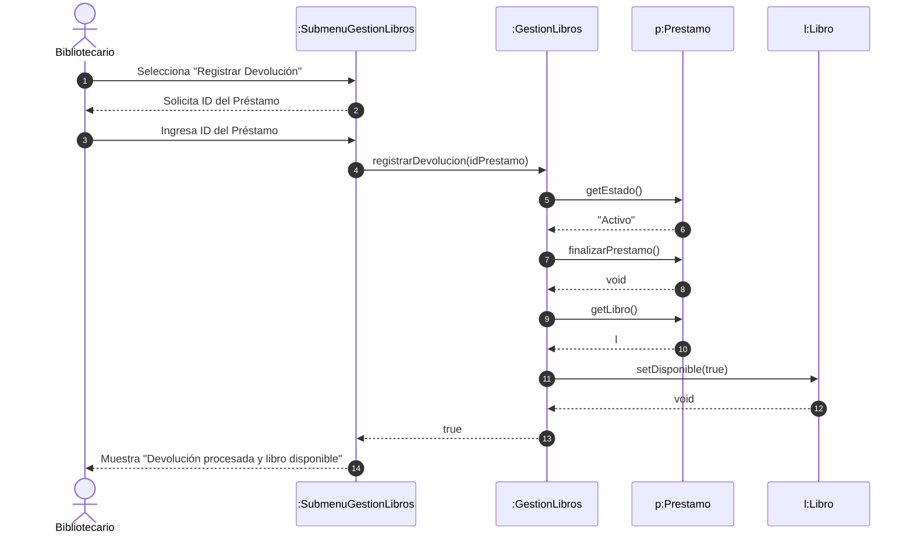
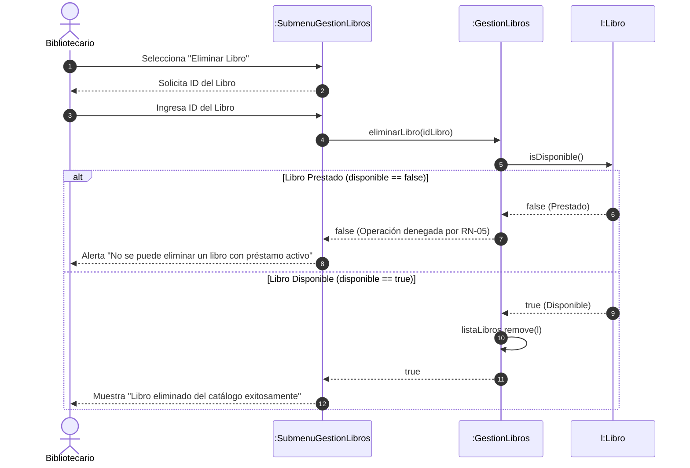
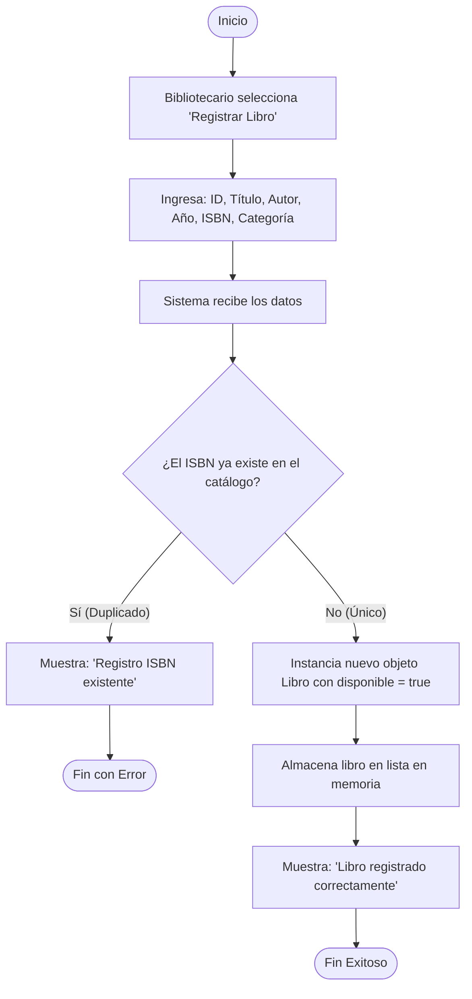
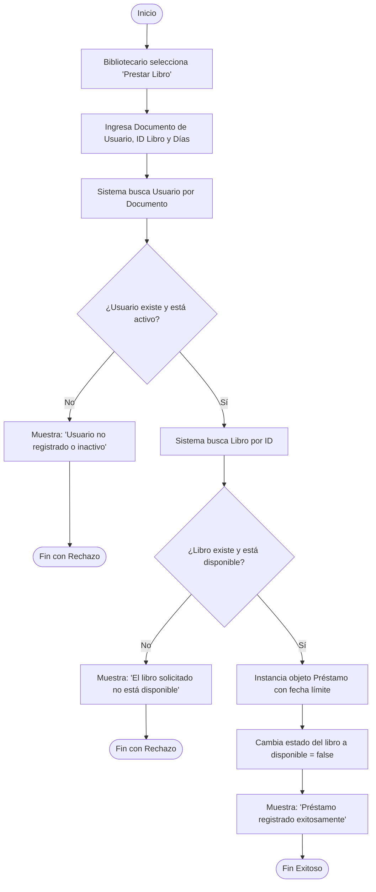
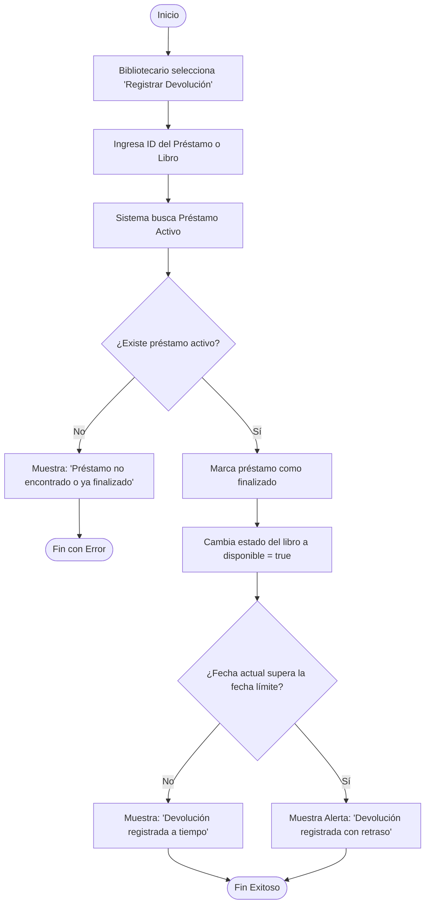

# FASE 3: DISEÑO Y MODELADO UML
## Sistema de Biblioteca Digital

> **Programa:** Análisis y Desarrollo de Software (ADSO) — SENA  
> **Ficha:** 3239188 | **Centro:** Centro de la Industria, la Empresa y los Servicios (CIES) — Neiva  
> **Instructor:** Carlos Julio Cadena  
> **Equipo 08:** Juan David Romero Calderón, Juan Diego Oteca Pedreros, Jhojan Javier Melo Avella  

---

## 1. Introducción al Diseño Arquitectónico

La Fase 3 traduce las especificaciones funcionales y de negocio consolidadas en las Fases 1 y 2 en un modelo estructural y dinámico bajo el paradigma de **Programación Orientada a Objetos (POO)**. 

El diseño se estructura en un patrón arquitectónico en tres capas desacopladas:
1. **Capa de Modelo (Dominio):** Clases de entidad que representan la realidad del negocio con encapsulamiento estricto (`Autor`, `Libro`, `Usuario`, `Prestamo`).
2. **Capa de Servicio (Lógica de Negocio):** Controlador transaccional (`GestionLibros`) que administra las colecciones dinámicas en memoria (`ArrayList`), ejecuta las validaciones y hace cumplir las reglas de negocio (RN-01 a RN-05).
3. **Capa de Presentación (Vista CLI):** Controlador de interfaz de consola (`SubmenuGestionLibros`) responsable de la interacción con el operador, captura segura con `Scanner` y presentación de menús.

---

## 2. Diagrama de Casos de Uso del Sistema (MVP)

Representa los límites del sistema, el actor primario (**Bibliotecario**) y las interacciones transaccionales del MVP con sus relaciones de inclusión (`<<include>>`) y extensión (`<<extend>>`).



---

## 3. Diagrama de Clases del Dominio y Servicios

Presenta la topología de clases, tipos de datos, visibilidad de atributos y signaturas de métodos, unificando todos los atributos acordados:



---

## 4. Diagramas de Secuencia (Interacción y Flujo Dinámico)

### 4.1. Prestar Libro (CU-05 / RN-04)
Modela el proceso transaccional de salida de un libro con validación del estado del usuario y disponibilidad física del ejemplar.

```mermaid
sequenceDiagram
    autonumber
    actor B as Bibliotecario
    participant V as :SubmenuGestionLibros
    participant S as :GestionLibros
    participant U as u:Usuario
    participant L as l:Libro
    participant P as p:Prestamo

    B ->> V: Selecciona "Prestar Libro"
    V -->> B: Solicita Documento Usuario, ID Libro y Días
    B ->> V: Ingresa datos requeridos
    V ->> S: realizarPrestamo(idLibro, docUsuario, dias)
    
    S ->> U: isActivo()
    U -->> S: true (Usuario Habilitado)
    
    S ->> L: isDisponible()
    L -->> S: true (Ejemplar en Anaquel)
    
    create participant P
    S ->> P: new Prestamo(id, u, l, fechaActual, fechaLimite)
    
    S ->> L: setDisponible(false)
    L -->> S: void
    
    S -->> V: true
    V -->> B: Muestra "Préstamo registrado exitosamente"
```

---

### 4.2. Registrar Devolución (CU-06)
Modela el reintegro de un ejemplar, el cierre del préstamo y el control de fecha límite para emitir la advertencia correspondiente.



---

### 4.3. Eliminar Libro con Validación de Préstamo Activo (CU-08 / RN-05)
Ilustra el cumplimiento estricto de la regla de integridad de inventario RN-05.



---

## 5. Diagramas de Actividades (Lógica de Procesos)

### 5.1. Proceso de Registro de Libro (CU-01 / RN-01)



---

### 5.2. Proceso de Préstamo de Libro (CU-05 / RN-04)



---

### 5.3. Proceso de Devolución y Control de Retraso (CU-06)


