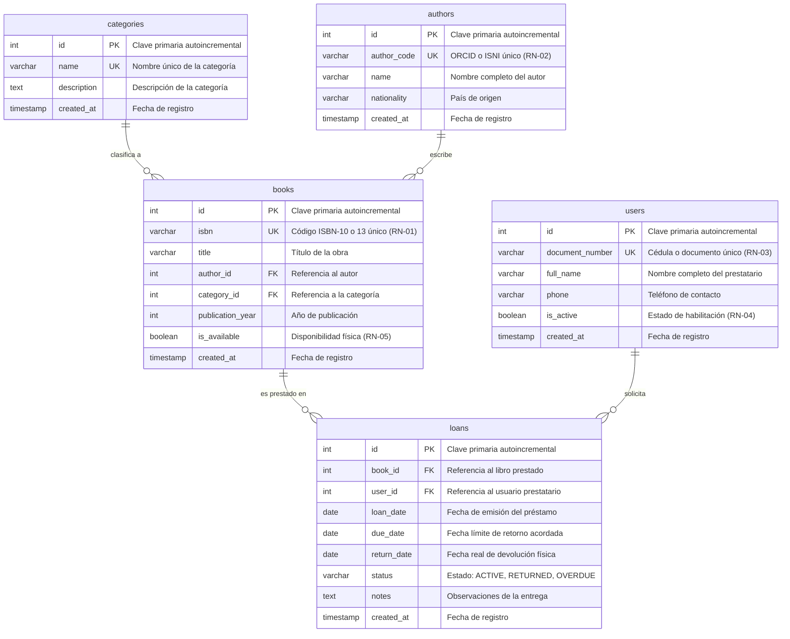

# FASE 4: DISEÑO DE BASE DE DATOS RELACIONAL Y PERSISTENCIA SQL
## Sistema de Biblioteca Digital

> **Programa:** Análisis y Desarrollo de Software (ADSO) — SENA  
> **Ficha:** 3239188 | **Centro:** Centro de la Industria, la Empresa y los Servicios (CIES) — Neiva  
> **Instructor Técnico:** Carlos Julio Cadena  
> **Equipo 08:** Juan David Romero Calderón, Juan Diego Oteca Pedreros, Jhojan Javier Melo Avella  

---

## 1. Introducción y Justificación del Modelo

La Fase 4 define la capa de persistencia relacional del **Sistema de Biblioteca Digital**, proporcionando un modelo de datos robusto, normalizado y optimizado bajo el motor **MySQL / MariaDB (InnoDB)**.

En estricto cumplimiento con la retroalimentación técnica del instructor Carlos Julio Cadena:
1. **Nomenclatura Estándar:** Las tablas se nombran en **plural** (`categories`, `authors`, `books`, `users`, `loans`) y todos los campos se encuentran estructurados en **idioma inglés**.
2. **Calidad Arquitectónica:** El esquema implementa **Tercera Forma Normal (3FN)**, eliminando redundancias, anomalías de inserción, actualización y borrado.
3. **Integridad Referencial:** Claves foráneas protegidas con políticas `ON UPDATE CASCADE` y `ON DELETE RESTRICT` para blindar las reglas de negocio del sistema.
4. **Correspondencia de Inventario (RS-04):** Conforme al alcance del MVP, cada fila en `books` representa un ejemplar físico individual (`is_available`), garantizando estricta coherencia con las restricciones y supuestos de las Fases 1, 2 y 3.

---

## 2. Proceso de Normalización (1FN, 2FN y 3FN)

### 2.1. Primera Forma Normal (1FN)
- **Criterio:** Todos los atributos contienen valores atómicos indivisibles y cada tabla posee una clave primaria unívoca.
- **Aplicación:**
  - En la entidad `authors`, el identificador único (`author_code`), el nombre y la nacionalidad son columnas independientes.
  - En `books`, el `isbn` es un campo atómico y se define `id` numérico autoincremental como identificador técnico.
  - Se eliminan listas repetitivas de libros en el usuario; las relaciones se modelan mediante tablas transaccionales.

### 2.2. Segunda Forma Normal (2FN)
- **Criterio:** Cumpliendo 1FN, ningún atributo no clave depende parcialmente de una parte de una clave compuesta (dependencia funcional completa).
- **Aplicación:**
  - Todas las tablas poseen una clave primaria simple (`id INT AUTO_INCREMENT`), lo que garantiza de forma natural que todos los atributos dependen directamente de la clave principal y no de subconjuntos de claves.
  - Los datos descriptivos de la categoría (`description`) dependen exclusivamente de `category_id`, por lo cual se extraen a la tabla independiente `categories`.

### 2.3. Tercera Forma Normal (3FN)
- **Criterio:** Cumpliendo 2FN, no existen dependencias funcionales transitivas entre atributos no clave (ningún atributo no clave depende de otro atributo no clave).
- **Aplicación:**
  - En `books`: Los datos del autor (`name`, `nationality`) no residen en la tabla de libros. Si residieran allí, `name` dependería de `author_id`, que a su vez depende de `id` (dependencia transitiva). Al segregar `authors` y dejar solo la clave foránea `author_id`, se elimina la transitividad.
  - En `loans`: La información del usuario (`full_name`, `phone`) y del libro (`title`, `isbn`) se referencia únicamente mediante `user_id` y `book_id`, asegurando cero redundancia de datos maestros.

---

## 3. Diagrama Entidad-Relación (ERD) en Mermaid

El siguiente diagrama representa el esquema relacional, los tipos de datos, las restricciones de clave y las cardinalidades de negocio:



---

## 4. Diccionario de Datos

### 4.1. Tabla: `categories`
| Campo | Tipo de Dato | Nulo | Clave | Valor por Defecto | Descripción |
| :--- | :--- | :---: | :---: | :--- | :--- |
| `id` | `INT` | NO | PK | `AUTO_INCREMENT` | Identificador único de la categoría. |
| `name` | `VARCHAR(50)` | NO | UK | — | Nombre temático único (ej. Novela, Ciencia). |
| `description` | `TEXT` | SÍ | — | `NULL` | Detalle o alcance temático de la categoría. |
| `created_at` | `TIMESTAMP` | NO | — | `CURRENT_TIMESTAMP` | Marca temporal de auditoría de creación. |

---

### 4.2. Tabla: `authors`
| Campo | Tipo de Dato | Nulo | Clave | Valor por Defecto | Descripción |
| :--- | :--- | :---: | :---: | :--- | :--- |
| `id` | `INT` | NO | PK | `AUTO_INCREMENT` | Identificador numérico interno del autor. |
| `author_code` | `VARCHAR(50)` | NO | UK | — | Código unívoco normalizado (ORCID/ISNI - RN-02). |
| `name` | `VARCHAR(150)` | NO | — | — | Nombre completo o seudónimo literario. |
| `nationality` | `VARCHAR(100)` | NO | — | — | País o nacionalidad del autor. |
| `created_at` | `TIMESTAMP` | NO | — | `CURRENT_TIMESTAMP` | Fecha y hora de ingreso al sistema. |

---

### 4.3. Tabla: `books`
| Campo | Tipo de Dato | Nulo | Clave | Valor por Defecto | Descripción |
| :--- | :--- | :---: | :---: | :--- | :--- |
| `id` | `INT` | NO | PK | `AUTO_INCREMENT` | Identificador único de inventario del libro. |
| `isbn` | `VARCHAR(20)` | NO | UK | — | Código internacional del libro único (RN-01). |
| `title` | `VARCHAR(200)` | NO | — | — | Título completo de la obra. |
| `author_id` | `INT` | NO | FK | — | Referencia a `authors(id)`. |
| `category_id` | `INT` | NO | FK | — | Referencia a `categories(id)`. |
| `publication_year`| `INT` | NO | — | — | Año de publicación del ejemplar. |
| `is_available` | `BOOLEAN` | NO | — | `TRUE` | `1` = En estantería, `0` = Prestado (RN-05). |
| `is_deleted` | `BOOLEAN` | NO | — | `FALSE` | `0` = Activo en catálogo. `1` = Baja lógica aplicada (Soft Delete). El registro no se borra físicamente para preservar el historial de préstamos. |
| `created_at` | `TIMESTAMP` | NO | — | `CURRENT_TIMESTAMP` | Fecha de catalogación. |

---

### 4.4. Tabla: `users`
| Campo | Tipo de Dato | Nulo | Clave | Valor por Defecto | Descripción |
| :--- | :--- | :---: | :---: | :--- | :--- |
| `id` | `INT` | NO | PK | `AUTO_INCREMENT` | Identificador interno del usuario. |
| `document_number`| `VARCHAR(20)` | NO | UK | — | Cédula o tarjeta de identidad única (RN-03). |
| `full_name` | `VARCHAR(150)` | NO | — | — | Nombre y apellidos del usuario. |
| `phone` | `VARCHAR(30)` | NO | — | — | Número telefónico de contacto. |
| `is_active` | `BOOLEAN` | NO | — | `TRUE` | Habilitado para solicitar préstamos (RN-04). |
| `created_at` | `TIMESTAMP` | NO | — | `CURRENT_TIMESTAMP` | Fecha de afiliación a la biblioteca. |

---

### 4.5. Tabla: `loans`
| Campo | Tipo de Dato | Nulo | Clave | Valor por Defecto | Descripción |
| :--- | :--- | :---: | :---: | :--- | :--- |
| `id` | `INT` | NO | PK | `AUTO_INCREMENT` | Número consecutivo del préstamo. |
| `book_id` | `INT` | NO | FK | — | Referencia a `books(id)` prestado. |
| `user_id` | `INT` | NO | FK | — | Referencia a `users(id)` prestatario. |
| `loan_date` | `DATE` | NO | — | — | Fecha de salida del material. |
| `due_date` | `DATE` | NO | — | — | Fecha máxima pactada para devolución. |
| `return_date` | `DATE` | SÍ | — | `NULL` | Fecha en que el libro fue reintegrado. |
| `status` | `VARCHAR(20)` | NO | — | `'ACTIVE'` | `'ACTIVE'`, `'RETURNED'` o `'OVERDUE'`. |
| `active_book_id` | `INT` | SÍ | UK | `VIRTUAL` | Columna generada: `IF(status = 'ACTIVE', book_id, NULL)`. Garantiza unicidad de préstamos activos (un solo ACTIVE por libro). Los préstamos devueltos se evalúan a NULL permitiendo múltiples registros históricos sin conflicto. |
| `notes` | `TEXT` | SÍ | — | `NULL` | Observaciones sobre el estado del libro. |
| `created_at` | `TIMESTAMP` | NO | — | `CURRENT_TIMESTAMP` | Registro transaccional en el sistema. |

---

## 5. Implementación de Reglas de Negocio en SQL

| Regla de Negocio | Descripción Formal | Mecanismo de Control en Base de Datos |
| :--- | :--- | :--- |
| **RN-01** | Unicidad de ISBN | Restricción `CONSTRAINT uk_books_isbn UNIQUE (isbn)`. |
| **RN-02** | Unicidad de Identificador de Autor | Restricción `CONSTRAINT uk_authors_code UNIQUE (author_code)`. |
| **RN-03** | Unicidad de Documento de Usuario | Restricción `CONSTRAINT uk_users_document UNIQUE (document_number)`. |
| **RN-04** | Usuario Habilitado | Restricción lógica `users.is_active = TRUE` en consultas de asignación de préstamos. |
| **RN-05 (Integridad)** | Unicidad de Préstamo Activo | Restricción física `CONSTRAINT uk_loans_active_book UNIQUE (active_book_id)` que impide a nivel de base de datos registrar dos préstamos activos del mismo libro simultáneamente. |
| **RN-05** | Integridad de Ejemplares en Préstamo | **Baja lógica (Soft Delete):** La eliminación se implementa como `UPDATE books SET is_deleted = TRUE`. La FK `fk_loans_books ON DELETE RESTRICT` se mantiene para preservar el historial de préstamos en `loans`. La validación previa comprueba que `is_available = TRUE` antes de ejecutar la baja; si el libro tiene préstamo activo (`is_available = FALSE`), la operación es bloqueada por la lógica de negocio. |

---

## 6. Instrucciones de Despliegue del Script SQL

El script oficial se encuentra ubicado en:  
👉 [`database/schema.sql`](../database/schema.sql)

### Ejecución mediante Consola MySQL:
```bash
mysql -u root -p < database/schema.sql
```

### Ejecución mediante MySQL Workbench o phpMyAdmin:
1. Abrir **MySQL Workbench** o **phpMyAdmin**.
2. Crear una nueva pestaña de consulta SQL.
3. Cargar el contenido de `database/schema.sql` y presionar **Execute (Ctrl + Shift + Enter)**.
4. El script creará la base de datos `digital_library`, sus 5 tablas, índices y datos semilla de prueba.
