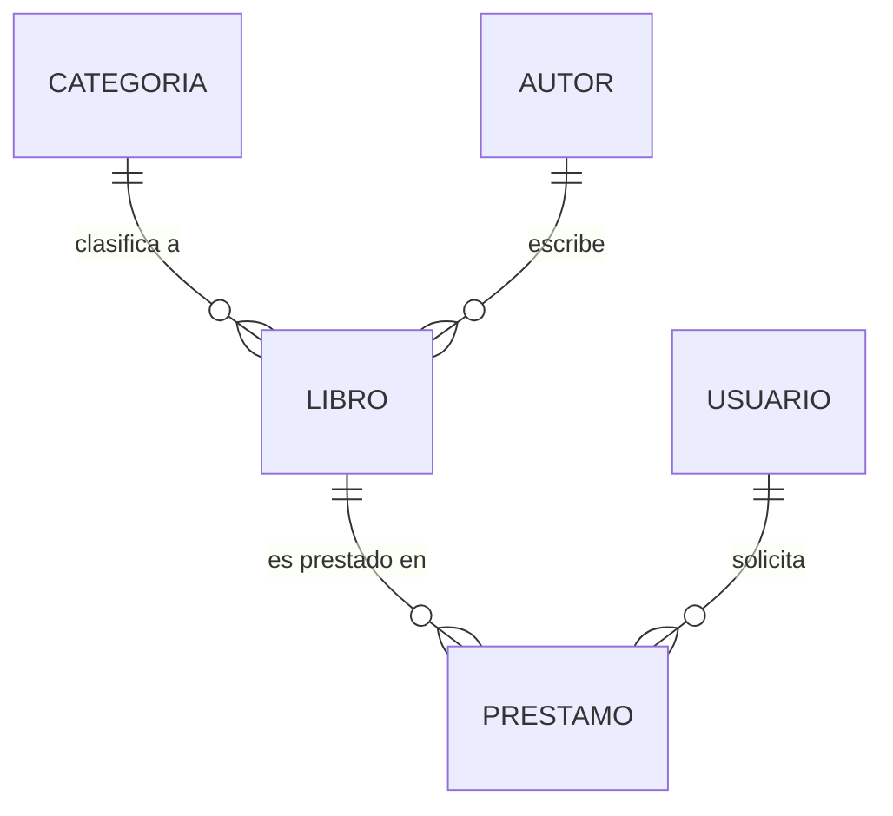
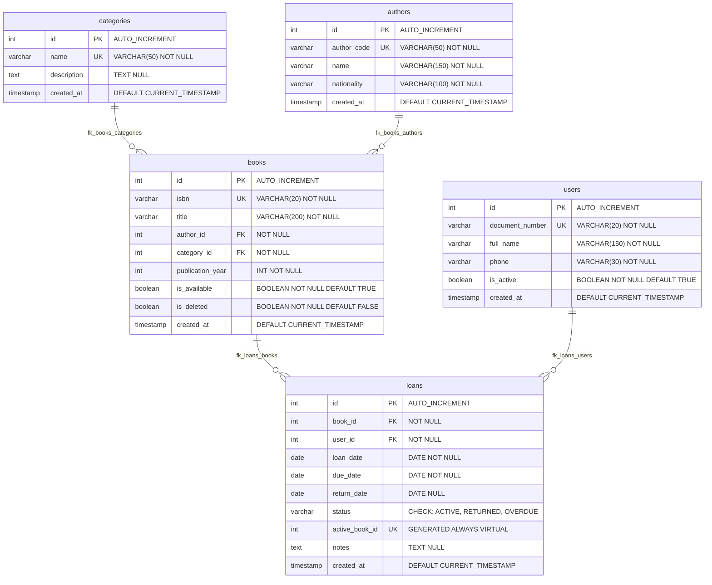

# FASE 4: DISEÑO DE BASE DE DATOS RELACIONAL Y PERSISTENCIA SQL
## Sistema de Biblioteca Digital

> **Programa:** Análisis y Desarrollo de Software (ADSO) — SENA  
> **Ficha:** 3239188 | **Centro:** Centro de la Industria, la Empresa y los Servicios (CIES) — Neiva  
> **Instructor Técnico:** Carlos Julio Cadena  
> **Equipo 08:** Juan David Romero Calderón, Juan Diego Oteca Pedreros, Jhojan Javier Melo Avella  

---

## 1. Introducción y Justificación del Modelo

La Fase 4 define la arquitectura y capa de persistencia relacional del **Sistema de Biblioteca Digital**, proporcionando un modelo de datos robusto, normalizado y optimizado bajo el motor **MySQL / MariaDB (InnoDB)**.

En estricto cumplimiento con la retroalimentación técnica del instructor Carlos Julio Cadena y la guía curricular del SENA:
1. **Modelado Arquitectónico Completo:** Se presentan de forma explícita y separada los tres niveles de abstracción: **Modelo Conceptual**, **Modelo Lógico** y **Modelo Físico**.
2. **Nomenclatura Estándar en Persistencia:** Las tablas se nombran en **plural** (`categories`, `authors`, `books`, `users`, `loans`) y todos los campos se estructuran en **idioma inglés**, manteniendo una correspondencia formal con el modelo de clases en español de la Fase 3.
3. **Calidad Arquitectónica:** El esquema implementa **Tercera Forma Normal (3FN)**, eliminando redundancias y dependencias transitivas.
4. **Integridad Referencial y Baja Lógica:** Claves foráneas protegidas con políticas `ON UPDATE CASCADE` y `ON DELETE RESTRICT`, complementadas con el patrón de **baja lógica (`is_deleted`)** para no violar el criterio de aceptación HU-08 CA-2 y preservar el historial para auditoría.
5. **Correspondencia de Inventario (RS-04):** Cada registro en `books` representa un ejemplar físico individual en estantería (`is_available`).

---

## 2. Niveles de Modelado de Datos

Siguiendo el ciclo de vida del diseño de bases de datos, se desarrollan las tres capas de abstracción:

### 2.1. Modelo Conceptual (Entidades y Relaciones de Negocio)
El modelo conceptual representa el dominio del problema libre de detalles técnicos de implementación, tipos de datos o claves foráneas. Define qué elementos existen en la biblioteca y cómo interactúan:



- **`CATEGORIA`:** Representa las áreas temáticas de clasificación bibliográfica.
- **`AUTOR`:** Creador intelectual del material con código normalizado.
- **`LIBRO`:** Ejemplar bibliográfico físico disponible en catálogo.
- **`USUARIO`:** Persona registrada y habilitada para solicitar préstamos.
- **`PRESTAMO`:** Transacción de salida y control de plazos que vincula a un usuario con un libro.

---

### 2.2. Modelo Lógico (Normalizado e Independiente del Motor)
El modelo lógico formaliza los atributos de cada entidad en **Tercera Forma Normal (3FN)**, especificando claves primarias (PK), claves candidatas de unicidad (UK), claves foráneas (FK) y cardinalidades de negocio:

```mermaid
erDiagram
    CATEGORIA ||--o{ LIBRO : "1 a muchos"
    AUTOR ||--o{ LIBRO : "1 a muchos"
    LIBRO ||--o{ PRESTAMO : "1 a muchos"
    USUARIO ||--o{ PRESTAMO : "1 a muchos"

    CATEGORIA {
        id PK "Clave primaria simple"
        nombre UK "Nombre único de clasificación"
        descripcion "Detalle temático"
    }

    AUTOR {
        id PK "Clave primaria simple"
        codigo_autor UK "Código normalizado ISNI u ORCID"
        nombre "Nombre completo o seudónimo"
        nacionalidad "País de procedencia"
    }

    LIBRO {
        id PK "Clave primaria simple"
        isbn UK "Código ISBN-10 o 13 único"
        titulo "Nombre de la obra"
        autor_id FK "Relación obligatoria con AUTOR"
        categoria_id FK "Relación obligatoria con CATEGORIA"
        anio_publicacion "Año de edición de la obra"
        disponible "Bandera de disponibilidad física"
        baja_logica "Bandera de estado de descarte"
    }

    USUARIO {
        id PK "Clave primaria simple"
        documento_identidad UK "Documento personal irrepetible"
        nombre_completo "Nombres y apellidos del afiliado"
        telefono "Medio de contacto"
        activo "Estado de habilitación para servicios"
    }

    PRESTAMO {
        id PK "Clave primaria simple"
        libro_id FK "Referencia al libro solicitado"
        usuario_id FK "Referencia al usuario responsable"
        fecha_salida "Fecha de entrega del material"
        fecha_limite "Fecha máxima acordada de retorno"
        fecha_reintegro "Fecha de devolución real"
        estado "Estado: ACTIVO, DEVUELTO, VENCIDO"
        observaciones "Anotaciones sobre el ejemplar"
    }
```

---

### 2.3. Tabla de Equivalencias de Dominio (Mapeo Español ↔ Inglés)
Para satisfacer la solicitud expresa del instructor Carlos Julio Cadena (*tablas en plural y campos en inglés*) sin alterar el modelo de objetos UML consolidado en español en las Fases 1 a 3, se establece la siguiente matriz canónica de mapeo:

| Entidad / Clase POO (Fase 3 - ES) | Tabla Relacional (Fase 4 - EN) | Mapeo de Atributos Principales | Justificación de Ingeniería |
| :--- | :--- | :--- | :--- |
| **`Categoria`** | `categories` | `nombre` ➔ `name`<br>`descripcion` ➔ `description` | Nomenclatura en plural y campos descriptivos en inglés. |
| **`Autor`** | `authors` | `identificador` ➔ `author_code`<br>`nombre` ➔ `name`<br>`nacionalidad` ➔ `nationality` | Soporte para identificadores internacionales (ISNI/ORCID). |
| **`Libro`** | `books` | `titulo` ➔ `title`<br>`isbn` ➔ `isbn`<br>`anioPublicacion` ➔ `publication_year`<br>`disponible` ➔ `is_available`<br>*Baja Lógica* ➔ `is_deleted` | Modelo físico de ejemplares individuales (RS-04) con soporte para baja lógica. |
| **`Usuario`** | `users` | `documentoIdentidad` ➔ `document_number`<br>`nombre` ➔ `full_name`<br>`telefono` ➔ `phone`<br>`activo` ➔ `is_active` | Padrón de usuarios habilitados y validados unívocamente. |
| **`Prestamo`** | `loans` | `fechaPrestamo` ➔ `loan_date`<br>`fechaLimiteDevolucion` ➔ `due_date`<br>`fechaDevolucion` ➔ `return_date`<br>`estado` ➔ `status` | Registro transaccional auditado con columna virtual única de control. |

---

## 3. Proceso de Normalización (1FN, 2FN y 3FN)

### 3.1. Primera Forma Normal (1FN)
- **Criterio:** Todos los atributos contienen valores atómicos indivisibles y cada tabla posee una clave primaria unívoca.
- **Aplicación:**
  - En la entidad `authors`, el identificador único (`author_code`), el nombre y la nacionalidad son columnas independientes.
  - En `books`, el `isbn` es un campo atómico y se define `id` numérico autoincremental como identificador técnico.
  - Se eliminan listas repetitivas de libros en el usuario; las relaciones se modelan mediante tablas transaccionales.

### 3.2. Segunda Forma Normal (2FN)
- **Criterio:** Cumpliendo 1FN, ningún atributo no clave depende parcialmente de una parte de una clave compuesta (dependencia funcional completa).
- **Aplicación:**
  - Todas las tablas poseen una clave primaria simple (`id INT AUTO_INCREMENT`), lo que garantiza de forma natural que todos los atributos dependen directamente de la clave principal y no de subconjuntos de claves.
  - Los datos descriptivos de la categoría (`description`) dependen exclusivamente de `category_id`, por lo cual se extraen a la tabla independiente `categories`.

### 3.3. Tercera Forma Normal (3FN)
- **Criterio:** Cumpliendo 2FN, no existen dependencias funcionales transitivas entre atributos no clave (ningún atributo no clave depende de otro atributo no clave).
- **Aplicación:**
  - En `books`: Los datos del autor (`name`, `nationality`) no residen en la tabla de libros. Si residieran allí, `name` dependería de `author_id`, que a su vez depende de `id` (dependencia transitiva). Al segregar `authors` y dejar solo la clave foránea `author_id`, se elimina la transitividad.
  - En `loans`: La información del usuario (`full_name`, `phone`) y del libro (`title`, `isbn`) se referencia únicamente mediante `user_id` y `book_id`, asegurando cero redundancia de datos maestros.

---

## 4. Modelo Físico Relacional y Diagrama ERD (MySQL / MariaDB)

El siguiente diagrama representa el esquema relacional físico con los tipos de datos exactos del motor InnoDB, claves e índices:



---

## 5. Diccionario de Datos

### 5.1. Tabla: `categories`
| Campo | Tipo de Dato | Nulo | Clave | Valor por Defecto | Descripción |
| :--- | :--- | :---: | :---: | :--- | :--- |
| `id` | `INT` | NO | PK | `AUTO_INCREMENT` | Identificador único de la categoría. |
| `name` | `VARCHAR(50)` | NO | UK | — | Nombre temático único (ej. Novela, Ciencia). |
| `description` | `TEXT` | SÍ | — | `NULL` | Detalle o alcance temático de la categoría. |
| `created_at` | `TIMESTAMP` | NO | — | `CURRENT_TIMESTAMP` | Marca temporal de auditoría de creación. |

---

### 5.2. Tabla: `authors`
| Campo | Tipo de Dato | Nulo | Clave | Valor por Defecto | Descripción |
| :--- | :--- | :---: | :---: | :--- | :--- |
| `id` | `INT` | NO | PK | `AUTO_INCREMENT` | Identificador numérico interno del autor. |
| `author_code` | `VARCHAR(50)` | NO | UK | — | Código unívoco normalizado (ISNI u ORCID - RN-02). |
| `name` | `VARCHAR(150)` | NO | — | — | Nombre completo o seudónimo literario. |
| `nationality` | `VARCHAR(100)` | NO | — | — | País o nacionalidad del autor. |
| `created_at` | `TIMESTAMP` | NO | — | `CURRENT_TIMESTAMP` | Fecha y hora de ingreso al sistema. |

---

### 5.3. Tabla: `books`
| Campo | Tipo de Dato | Nulo | Clave | Valor por Defecto | Descripción |
| :--- | :--- | :---: | :---: | :--- | :--- |
| `id` | `INT` | NO | PK | `AUTO_INCREMENT` | Identificador único de inventario del libro. |
| `isbn` | `VARCHAR(20)` | NO | UK | — | Código internacional del libro único (RN-01). |
| `title` | `VARCHAR(200)` | NO | — | — | Título completo de la obra. |
| `author_id` | `INT` | NO | FK | — | Referencia a `authors(id)`. |
| `category_id` | `INT` | NO | FK | — | Referencia a `categories(id)`. |
| `publication_year`| `INT` | NO | — | — | Año de publicación del ejemplar. |
| `is_available` | `BOOLEAN` | NO | — | `TRUE` | `1` = En estantería, `0` = Prestado (RN-05). |
| `is_deleted` | `BOOLEAN` | NO | — | `FALSE` | `0` = Activo en catálogo. `1` = Baja lógica aplicada (Soft Delete). |
| `created_at` | `TIMESTAMP` | NO | — | `CURRENT_TIMESTAMP` | Fecha de catalogación. |

---

### 5.4. Tabla: `users`
| Campo | Tipo de Dato | Nulo | Clave | Valor por Defecto | Descripción |
| :--- | :--- | :---: | :---: | :--- | :--- |
| `id` | `INT` | NO | PK | `AUTO_INCREMENT` | Identificador interno del usuario. |
| `document_number`| `VARCHAR(20)` | NO | UK | — | Cédula o tarjeta de identidad única (RN-03). |
| `full_name` | `VARCHAR(150)` | NO | — | — | Nombre y apellidos del usuario. |
| `phone` | `VARCHAR(30)` | NO | — | — | Número telefónico de contacto. |
| `is_active` | `BOOLEAN` | NO | — | `TRUE` | Habilitado para solicitar préstamos (RN-04). |
| `created_at` | `TIMESTAMP` | NO | — | `CURRENT_TIMESTAMP` | Fecha de afiliación a la biblioteca. |

---

### 5.5. Tabla: `loans`
| Campo | Tipo de Dato | Nulo | Clave | Valor por Defecto | Descripción |
| :--- | :--- | :---: | :---: | :--- | :--- |
| `id` | `INT` | NO | PK | `AUTO_INCREMENT` | Número consecutivo del préstamo. |
| `book_id` | `INT` | NO | FK | — | Referencia a `books(id)` prestado. |
| `user_id` | `INT` | NO | FK | — | Referencia a `users(id)` prestatario. |
| `loan_date` | `DATE` | NO | — | — | Fecha de salida del material. |
| `due_date` | `DATE` | NO | — | — | Fecha máxima pactada para devolución. |
| `return_date` | `DATE` | SÍ | — | `NULL` | Fecha en que el libro fue reintegrado. |
| `status` | `VARCHAR(20)` | NO | — | `'ACTIVE'` | `'ACTIVE'`, `'RETURNED'` o `'OVERDUE'`. |
| `active_book_id` | `INT` | SÍ | UK | `VIRTUAL` | Columna generada: `IF(status = 'ACTIVE', book_id, NULL)`. Garantiza un solo préstamo activo por libro. |
| `notes` | `TEXT` | SÍ | — | `NULL` | Observaciones sobre el estado del libro. |
| `created_at` | `TIMESTAMP` | NO | — | `CURRENT_TIMESTAMP` | Registro transaccional en el sistema. |

---

## 6. Implementación de Reglas de Negocio en SQL

| Regla de Negocio | Descripción Formal | Mecanismo de Control en Base de Datos |
| :--- | :--- | :--- |
| **RN-01** | Unicidad de ISBN | Restricción `CONSTRAINT uk_books_isbn UNIQUE (isbn)`. |
| **RN-02** | Unicidad de Identificador de Autor | Restricción `CONSTRAINT uk_authors_code UNIQUE (author_code)`. |
| **RN-03** | Unicidad de Documento de Usuario | Restricción `CONSTRAINT uk_users_document UNIQUE (document_number)`. |
| **RN-04** | Usuario Habilitado | Restricción lógica `users.is_active = TRUE` en consultas de asignación de préstamos. |
| **RN-05 (Integridad)** | Unicidad de Préstamo Activo | Restricción física `CONSTRAINT uk_loans_active_book UNIQUE (active_book_id)` que impide registrar dos préstamos activos del mismo libro simultáneamente. |
| **RN-05 (Baja Lógica)** | Integridad de Historial de Préstamos | La eliminación se implementa como `UPDATE books SET is_deleted = TRUE`. La FK `fk_loans_books ON DELETE RESTRICT` se mantiene para preservar el historial de préstamos en `loans`. |

### 📌 Justificación Arquitectónica del Estado `OVERDUE`:
En el esquema de base de datos se mantiene el estado `'OVERDUE'` dentro del `CONSTRAINT chk_loans_status CHECK (status IN ('ACTIVE', 'RETURNED', 'OVERDUE'))` por los siguientes motivos de diseño:
1. **Doble modalidad de cálculo:** En las operaciones del día a día, la condición de mora se evalúa dinámicamente en consultas (`CURRENT_DATE > due_date`).
2. **Registro de cierre de auditoría:** Cuando un préstamo finaliza fuera del plazo pactado (HU-06 CA-2), o cuando el sistema ejecute cierres periódicos para sancionar al usuario (HU-10 en fases futuras), el registro requiere un estado terminal explícito que conserve la trazabilidad del incumplimiento sin depender de la fecha actual de consulta.

---

## 7. Instrucciones de Despliegue del Script SQL

El script oficial se encuentra ubicado en:  
👉 [`database/schema.sql`](../database/schema.sql)

### Ejecución mediante Consola MySQL:
```bash
mysql -u root -p < database/schema.sql
```

### Ejecución mediante MySQL Workbench o phpMyAdmin:
1. Abrir **MySQL Workbench** o **phpMyAdmin**.
2. Crear una nueva pestaña de consulta SQL.
3. Cargar el contenido de `database/schema.sql` y presionar **Execute (Ctrl + Shift + Enter)**.
4. El script creará la base de datos `digital_library`, sus 5 tablas, índices y datos semilla de prueba.
