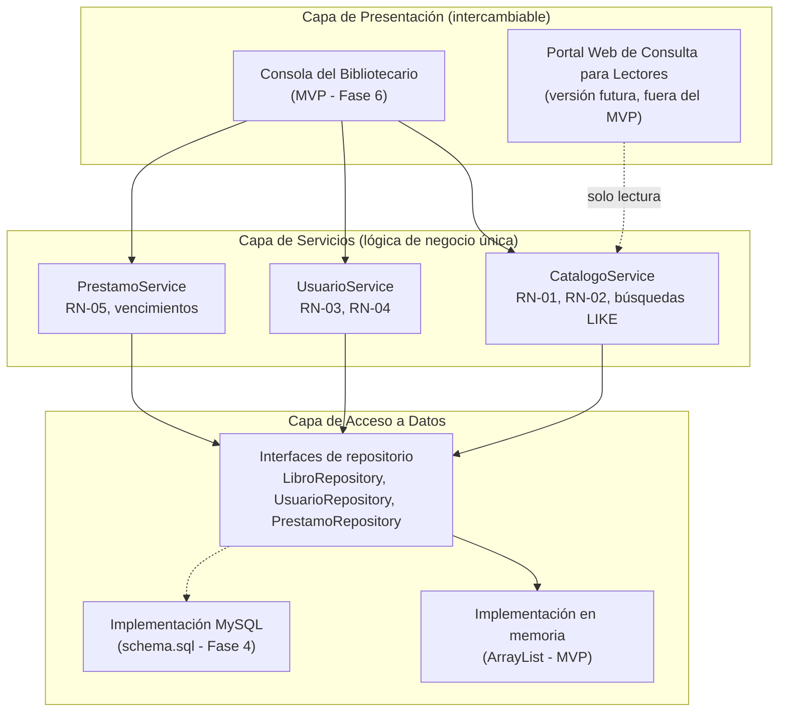

# FASE 5: MOCKUP, PROTOTIPO Y FLUJOS DE NAVEGACIÓN
## Sistema de Biblioteca Digital (CLI MVP y Prototipo)

> **Programa:** Análisis y Desarrollo de Software (ADSO) — SENA  
> **Ficha:** 3239188 | **Centro:** Centro de la Industria, la Empresa y los Servicios (CIES) — Neiva  
> **Instructor Técnico:** Carlos Julio Cadena  
> **Equipo 08:** Juan David Romero Calderón, Juan Diego Oteca Pedreros, Jhojan Javier Melo Avella  

---

## 1. Introducción y Propósito del Prototipado

La **Fase 5** materializa la experiencia de usuario (UX) y el diseño de interacción de la interfaz de consola de comandos (**CLI - Command Line Interface**) y prototipo navegable antes de abordar la fase final de programación.

El objetivo central es validar:
- La jerarquía y navegabilidad entre menús y submenús con migas de pan textuales (**Breadcrumbs**).
- La captura asistida y búsqueda guiada de relaciones (eliminando la fricción de memorizar códigos ISNI o IDs numéricos).
- El formato tabular de salida para reportes y listados con anchos dinámicos y elipsis formales.
- La paleta de secuencias de escape ANSI de alto contraste conforme a principios de accesibilidad.
- La retroalimentación visual inmediata ante aciertos y errores (mensajes de validación de reglas de negocio RN-01 a RN-05).

> [!NOTE]
> **Alcance de Acceso (HU-12):** En conformidad con la priorización MoSCoW del MVP, el software opera en una terminal monousuario centralizada para el rol **Bibliotecario**, por lo cual la pantalla de Login con contraseñas queda formalmente excluida de esta versión.

---

## 2. Mapa y Estructura de Navegación del Sistema

El siguiente diagrama modela el árbol de navegación completo de la interfaz de consola:


---

## 3. Wireframes de Pantalla de Inicio y Dashboard Principal

### 3.1. Pantalla de Bienvenida y Dashboard CLI
Esta es la vista raíz que recibe al bibliotecario al iniciar la aplicación:

```text
================================================================================
          SISTEMA DE GESTIÓN DE BIBLIOTECA DIGITAL — CIES NEIVA
                             (MVP - VERSIÓN 1.0)
================================================================================
 Operador Activo: Bibliotecario de Turno | Fecha del Sistema: 2026-10-25
--------------------------------------------------------------------------------
 [⚠ ATENCIÓN] 2 préstamos vencidos y 1 préstamo vence en las próximas 48 horas.
              Consulte: [9] Reportes > [3] Préstamos Activos y Vencidos
--------------------------------------------------------------------------------
 [1] Registrar nuevo libro en catálogo
 [2] Registrar nuevo autor
 [3] Registrar nuevo usuario prestatario
 [4] Buscar libro por ID
 [5] Buscar libros por Título o Autor
 [6] Modificar datos de libro
 [7] Dar de baja libro del catálogo (Baja lógica)
 [8] Gestión de Préstamos y Devoluciones (Transacciones)
 [9] Módulo de Reportes y Listados
 [0] Salir del sistema
================================================================================
 Ingrese una opción numérica (0-9): _
```

> **Alerta proactiva de vencimientos (Obs 12):** cada vez que se muestra el menú principal, el sistema consulta los préstamos activos y, si hay préstamos vencidos o que vencen en las próximas 48 horas, imprime el aviso `[⚠ ATENCIÓN]` antes de las opciones. Si no hay préstamos en riesgo, la línea no aparece.

---

## 4. Wireframes de Formularios de Captura de Datos Asistida (Obs 01 & Obs 03)

### 4.1. Formulario 1: Registrar Libro (HU-01 / RF-01)
El bibliotecario **nunca digita códigos de memoria**:
- El ID del libro lo asigna el sistema automáticamente (`AUTO_INCREMENT`).
- El autor se busca escribiendo parte del nombre o apellido (por ejemplo, `García`) o `?` para ver la lista completa. Solo quien ya conoce el ISNI lo digita directamente.
- La categoría se elige de una lista numerada.
- En cualquier campo de texto, la tecla `TAB` autocompleta con los valores registrados (JLine 3, ver sección 7).

```text
================================================================================
Ruta: Menú Principal > [1] Registrar Nuevo Libro en Catálogo
[Presione 0 o ESC para cancelar y regresar]
================================================================================
 Ingrese Título: Cien años de soledad
 Autor (escriba nombre/apellido, ISNI o '?' para ver todos): García
 >> Coincidencias encontradas:
    [1] Gabriel García Márquez (ISNI: 0000-0001-2141-4109)
 Seleccione autor (1..N) o 0 para buscar de nuevo: 1
 [✔] Autor asociado: Gabriel García Márquez
 Ingrese Año de Publicación (1000 - año actual): 1967
 Ingrese Código ISBN (10 o 13 dígitos): 978-0307474728
 >> Categorías disponibles:
    [1] Novela y Ficción   [2] Ciencia y Tecnología   [3] Historia y Filosofía
 Seleccione categoría (1..N): 1
--------------------------------------------------------------------------------
 [SISTEMA] Validando formato y unicidad de ISBN (RN-01)...
 [✔ ÉXITO] Libro #101 registrado en el catálogo con estado: DISPONIBLE.
 Presione ENTER para continuar...
```

Variante con el comodín `?` (cuando no se recuerda ni el apellido):

```text
 Autor (escriba nombre/apellido, ISNI o '?' para ver todos): ?
 >> Autores registrados (orden alfabético):
    [1] Gabriel García Márquez        (ISNI: 0000-0001-2141-4109)
    [2] Miguel de Cervantes Saavedra  (ISNI: 0000-0001-2144-5430)
    [3] Robert C. Martin              (ORCID: 0000-0003-4512-9901)
 Seleccione autor (1..N) o 0 para buscar de nuevo: 2
 [✔] Autor asociado: Miguel de Cervantes Saavedra
```

Si la búsqueda no encuentra coincidencias, el sistema no aborta el formulario: ofrece `[1] Buscar de nuevo` o `[2] Registrar el autor ahora` (abre el Formulario 2 y regresa al mismo punto con el autor recién creado ya asociado).

---

### 4.2. Formulario 2: Registrar Autor (HU-02 / RF-02)
Formulario invocado al catalogar un autor nuevo con validación estructural:

```text
================================================================================
Ruta: Menú Principal > [2] Registrar Nuevo Autor
[Presione 0 o ESC para cancelar y regresar]
================================================================================
 Ingrese Código Normalizado (ISNI / ORCID, formato 0000-0000-0000-000X): 12345
 [✖ VALIDACIÓN]: El código debe tener 16 caracteres en bloques de 4 (0000-0000-0000-000X).
 Ingrese Código Normalizado (ISNI / ORCID, formato 0000-0000-0000-000X): 0000-0001-2141-4109
 Ingrese Nombre Completo del Autor: Gabriel García Márquez
 Ingrese Nacionalidad: Colombiana
--------------------------------------------------------------------------------
 [SISTEMA] Validando unicidad de identificador (RN-02)...
 [✔ ÉXITO] Autor registrado correctamente en la base de datos de autores.
 Presione ENTER para continuar...
```

---

### 4.3. Formulario 3: Registrar Usuario (HU-03 / RF-03)
Alta de prestatario con validación de documento único y teléfono de 10 dígitos:

```text
================================================================================
Ruta: Menú Principal > [3] Registrar Nuevo Usuario Prestatario
[Presione 0 o ESC para cancelar y regresar]
================================================================================
 Ingrese Número de Documento de Identidad (6-15 dígitos): 1075248911
 Ingrese Nombre Completo: Juan David Romero Calderón
 Ingrese Número Telefónico (10 dígitos): 3124567890
--------------------------------------------------------------------------------
 [SISTEMA] Validando documento (RN-03)...
 [✔ ÉXITO] Usuario registrado exitosamente con estado: ACTIVO.
 Presione ENTER para continuar...
```

---

### 4.4. Formulario 4: Prestar Libro Asistido (HU-05 / RF-05 / Obs 01 & 03)
Captura transaccional de préstamo con búsqueda guiada de lectores y títulos:

```text
================================================================================
Ruta: Menú Principal > [8] Gestión de Préstamos > [1] Registrar Salida (Préstamo)
[Presione 0 o ESC para cancelar y regresar]
================================================================================
 Ingrese Documento o Nombre del Lector: David
 >> Coincidencias encontradas:
    [1] Juan David Romero Calderón (Doc: 1075248911 | Estado: ACTIVO)
 Seleccione lector (1..N): 1
 [✔] Lector seleccionado: Juan David Romero Calderón | Estado: HABILITADO

 Ingrese ID, Título o ISBN del Libro a Prestar: Cien
 >> Coincidencias encontradas:
    [1] [#101] Cien años de soledad — G. García Márquez (DISPONIBLE)
 Seleccione ejemplar (1..N): 1
 [✔] Libro seleccionado: "Cien años de soledad" | Estado: DISPONIBLE

 Ingrese Días de Préstamo pactados (1-30) [Por defecto: 14]: 14
--------------------------------------------------------------------------------
 [SISTEMA] Calculando fecha límite: 2026-11-08...
 [SISTEMA] Actualizando estado del libro a NO DISPONIBLE...
 [✔ ÉXITO] Préstamo #1001 registrado exitosamente.
 Presione ENTER para continuar...
```

---

### 4.5. Formulario 5: Registrar Devolución (HU-06 / RF-06)
Reintegro de material y control de entrega a tiempo o tardía:

```text
================================================================================
Ruta: Menú Principal > [8] Gestión de Préstamos > [2] Registrar Devolución Física
[Presione 0 o ESC para cancelar y regresar]
================================================================================
 Ingrese ID del Préstamo o ID del Libro: 1001
 [✔] Préstamo Activo Encontrado:
     - Libro: "Cien años de soledad" (ID: 101)
     - Usuario: Juan David Romero Calderón (Doc: 1075248911)
     - Fecha Préstamo: 2026-10-25 | Fecha Límite Pactada: 2026-11-08
     - Fecha Actual del Sistema: 2026-11-01
--------------------------------------------------------------------------------
 Confirmar recepción física del ejemplar (S/N): S
 [SISTEMA] Validando fechas...
 [✔ ÉXITO] Devolución registrada a tiempo. Préstamo cerrado y libro DISPONIBLE.
 Presione ENTER para continuar...
```

---

## 5. Wireframes de Listados, Búsquedas y Reportes (Obs 05: Formato Tabular Dinámico)

### 5.1. Consulta Rápida de Disponibilidad (HU-04 / RF-04)

```text
================================================================================
Ruta: Menú Principal > [4] Buscar Libro por ID / Disponibilidad
[Presione 0 o ESC para volver]
================================================================================
 Ingrese ID numérico o título del libro: Cien años de soledad

 [FICHA TÉCNICA DEL EJEMPLAR]
  ID Numérico: 101
  Título de la Obra: Cien años de soledad
  Código ISBN: 978-0307474728
  Autor Maestro: Gabriel García Márquez (Colombiana)
  Categoría Temática: Novela y Ficción
  ESTADO DE DISPONIBILIDAD: [ NO DISPONIBLE - EN PRÉSTAMO ACTIVO ]
  Fecha Límite Pactada de Devolución: 2026-11-08
  Lector Asignado: Juan David Romero Calderón (Tel: 3124567890)
--------------------------------------------------------------------------------
 Presione ENTER para volver...
```

---

### 5.2. Búsqueda por Título o Autor con Elipsis Formal (HU-07 / RF-07 / Obs 05)
Las tablas de salida se imprimen con formato tabular (`System.out.printf` / `String.format`). El ancho de cada columna se calcula a partir del texto más largo del resultado, con un tope de 30 caracteres para el título. Cuando un título supera el tope, se corta en una frontera de palabra y se completa con punto suspensivo formal (`...`), nunca a mitad de palabra sin indicarlo:

```java
// Regla de recorte: máximo 'ancho' caracteres, incluyendo los tres puntos.
static String ajustar(String texto, int ancho) {
    if (texto.length() <= ancho) return texto;
    String corte = texto.substring(0, ancho - 3);
    int espacio = corte.lastIndexOf(' ');
    if (espacio > ancho / 2) corte = corte.substring(0, espacio);
    return corte.stripTrailing() + "...";
}
// Uso: System.out.printf(" %-4d | %-15s | %-30s | %-16s | %s%n", id, isbn, ajustar(titulo, 30), autor, estado);
```

Resultado en pantalla:

```text
================================================================================
Ruta: Menú Principal > [5] Búsqueda por Título o Autor (Coincidencia Parcial)
[Presione 0 o ESC para volver]
================================================================================
 Criterio de búsqueda: "García"
--------------------------------------------------------------------------------
 ID   | ISBN            | TÍTULO DE LA OBRA              | AUTOR            | ESTADO
------+-----------------+--------------------------------+------------------+------------
 101  | 978-0307474728  | Cien años de soledad           | G. García M.     | Prestado
 104  | 978-0307387738  | El amor en los tiempos del...  | G. García M.     | Disponible
 108  | 978-9580424567  | Crónica de una muerte...       | G. García M.     | Disponible
--------------------------------------------------------------------------------
 Total de coincidencias encontradas: 3 registros activos.
 Presione ENTER para volver al menú principal...
```

---

### 5.3. Reporte de Préstamos Activos y Alertas de Vencimiento (HU-09 / Obs 12)

```text
================================================================================
Ruta: Menú Principal > [9] Módulo de Reportes > [3] Préstamos Activos y Vencidos
[Presione 0 o ESC para volver]
================================================================================
 Fecha del Sistema: 2026-11-07
 ID P. | TÍTULO DEL LIBRO               | PRESTATARIO       | EMISIÓN    | VENCE      | ESTADO
-------+--------------------------------+-------------------+------------+------------+--------------
 1002  | Clean Code: A Handbook of...   | Juan Diego Oteca  | 2026-10-15 | 2026-10-29 | ✖ VENCIDO
 1003  | Don Quijote de la Mancha       | Jhojan Melo       | 2026-10-18 | 2026-10-28 | ✖ VENCIDO
 1001  | Cien años de soledad           | Juan David Romero | 2026-10-25 | 2026-11-08 | ⚠ VENCE PRONTO
================================================================================
 Resumen: ✖ En mora: 2 | ⚠ Vencen en 48 h: 1 | En curso sin riesgo: 0
 Presione ENTER para volver...
```

El reporte se ordena por prioridad: primero los vencidos, luego los que vencen en las próximas 48 horas y al final los que no tienen riesgo. Cada estado lleva símbolo y texto, de modo que no depende del color.

---

## 6. Catálogo Visual de Mensajes de Validación y Error

Para cumplir con el estándar **RNF-03 (Usabilidad)** y **RNF-02 (Confiabilidad)**, el sistema maneja plantillas gráficas estandarizadas para evitar cierres abruptos:

| Tipo | Evento / Regla | Representación Visual en Consola CLI |
| :---: | :--- | :--- |
| **Error** | ISBN Duplicado (RN-01) | `[✖ ERROR]: Registro ISBN existente.` |
| **Error** | Autor Duplicado (RN-02) | `[✖ ERROR]: Este identificador ya se encuentra registrado para otro autor.` |
| **Error** | Documento Duplicado (RN-03) | `[✖ ERROR]: Este documento ya se encuentra registrado.` |
| **Error** | Usuario Inactivo (RN-04) | `[✖ ERROR]: Usuario no habilitado para préstamos. Estado actual: INACTIVO.` |
| **Error** | Libro Prestado (RF-05) | `[✖ ERROR]: El libro seleccionado no cuenta con existencias disponibles para préstamo.` |
| **Error** | Eliminación Denegada (RN-05) | `[✖ ERROR]: No se puede eliminar un libro que tiene un préstamo activo.` |
| **Error** | Campo Vacío (CA-2) | `[✖ VALIDACIÓN]: Campo obligatorio. Diligencie la información requerida.` |
| **Alerta** | Devolución Tardía (HU-06) | `[⚠ ADVERTENCIA]: Devolución registrada con retraso. Plazo vencido.` |
| **Alerta** | Préstamo por Vencer | `[⚠ ATENCIÓN]: El préstamo vence en las próximas 48 horas.` |
| **Éxito** | Transacción OK | `[✔ ÉXITO]: Operación procesada y confirmada en memoria.` |

---

## 7. Estándar de Colores ANSI y Accesibilidad en Consola (Obs 02)

### 7.1. Biblioteca de terminal adoptada

La consola se construye sobre **JLine 3** (`org.jline:jline`), la biblioteca estándar de Java para interfaces de terminal (la usan Maven, Gradle y JShell). En Windows usa internamente **Jansi** para habilitar las secuencias ANSI. JLine resuelve tres compromisos de la auditoría a la vez:

| Necesidad | Cómo la resuelve JLine 3 |
| :--- | :--- |
| Colores ANSI consistentes en Linux, macOS y Windows (Obs 02) | `AttributedStringBuilder` + `AttributedStyle` emiten las secuencias ANSI y las traducen en la consola de Windows. |
| Tecla `ESC` para cancelar (Obs 03) | `Terminal.enterRawMode()` con `NonBlockingReader` lee cada tecla al instante y detecta `ESC` (código 27) sin esperar `ENTER`, cosa que `Scanner` no puede hacer. Escribir `0` + `ENTER` también cancela, para terminales sin modo raw. |
| Búsqueda asistida de autores, lectores y libros (Obs 01) | `Completer` con los nombres registrados: la tecla `TAB` sugiere coincidencias mientras se escribe. |

### 7.2. Paleta de alto contraste según el fondo de la terminal

Usar un solo color para todos los fondos es justamente lo que produce bajo contraste (amarillo o verde brillante sobre fondo blanco). Por eso la consola define **dos paletas** y elige una al iniciar:

1. Si existe la variable `NO_COLOR`, se usa la opción `--sin-color`, o la salida no es una terminal (por ejemplo, redirigida a un archivo), **no se emite ningún color**.
2. Si el usuario pasa `--tema=claro` o `--tema=oscuro`, se respeta su elección.
3. Si no, se detecta el fondo con la variable `COLORFGBG` (la publican la mayoría de terminales); si no está disponible, se usa la paleta oscura.

Los **encabezados no usan color**: van en negrita con el color de texto propio de la terminal (`\033[1m`), que siempre tiene el máximo contraste con su fondo. Los colores usan la gama de 256 colores, no los 8 colores básicos, cuyo tono real cambia de una terminal a otra.

| Elemento CLI | Paleta oscura (fondo negro) | Contraste | Paleta clara (fondo blanco) | Contraste | Símbolo obligatorio |
| :--- | :--- | :---: | :--- | :---: | :--- |
| **Encabezados / Títulos** | `\033[1m` negrita, color de texto de la terminal | Máximo | `\033[1m` negrita, color de texto de la terminal | Máximo | — |
| **Ruta (breadcrumb)** | `\033[38;5;117m` azul cielo `#87D7FF` | 13:1 | `\033[38;5;24m` azul petróleo `#005F87` | 7:1 | `Ruta:` |
| **Éxito** | `\033[38;5;114m` verde `#87D787` | 12:1 | `\033[38;5;28m` verde `#008700` | 4,7:1 | `[✔ ÉXITO]` |
| **Advertencia** | `\033[38;5;221m` ámbar `#FFD75F` | 15:1 | `\033[38;5;130m` ocre `#AF5F00` | 4,7:1 | `[⚠ ADVERTENCIA]` |
| **Error** | `\033[38;5;203m` rojo coral `#FF5F5F` | 7:1 | `\033[38;5;124m` rojo oscuro `#AF0000` | 7,4:1 | `[✖ ERROR]` |
| **Ayuda / texto secundario** | `\033[38;5;246m` gris `#949494` | 6,9:1 | `\033[38;5;242m` gris `#6C6C6C` | 5,3:1 | — |
| **Restablecer** | `\033[0m` | — | `\033[0m` | — | Se emite al final de cada mensaje. |

Todos los pares superan la relación mínima de **4,5:1 de WCAG 2.1 (nivel AA)** para texto normal. Como cada estado lleva siempre su símbolo y su palabra (`ÉXITO`, `ADVERTENCIA`, `ERROR`), el mensaje se entiende igual aunque los colores estén desactivados o el usuario no distinga colores.

### 7.3. Soporte de caracteres UTF-8 (tildes, eñes y símbolos)

- La aplicación se ejecuta con `-Dstdout.encoding=UTF-8 -Dstderr.encoding=UTF-8` (Java 18+ ya usa UTF-8 por defecto, JEP 400).
- En Windows, JLine/Jansi activa la página de códigos UTF-8 de la consola; en terminales antiguas basta con ejecutar `chcp 65001` antes de iniciar.
- Si la terminal no puede mostrar `✔ ✖ ⚠`, la consola los reemplaza por equivalentes ASCII: `[OK]`, `[X]` y `[!]`.

### 7.4. Implementación de referencia

```java
public final class Estilos {
    public enum Tema { OSCURO, CLARO, SIN_COLOR }

    private static Tema tema = detectarTema();

    static Tema detectarTema() {
        if (System.getenv("NO_COLOR") != null || System.console() == null) return Tema.SIN_COLOR;
        String fgbg = System.getenv("COLORFGBG");            // ej. "0;15" = texto negro sobre fondo blanco
        if (fgbg != null && fgbg.matches(".*;(7|15)$")) return Tema.CLARO;
        return Tema.OSCURO;
    }

    public static void usarTema(Tema t) { tema = t; }        // --tema=claro | --tema=oscuro | --sin-color

    private static String pintar(String texto, int colorOscuro, int colorClaro) {
        if (tema == Tema.SIN_COLOR) return texto;
        int c = (tema == Tema.CLARO) ? colorClaro : colorOscuro;
        return "\033[38;5;" + c + "m" + texto + "\033[0m";
    }

    public static String titulo(String t)      { return tema == Tema.SIN_COLOR ? t : "\033[1m" + t + "\033[0m"; }
    public static String ruta(String t)        { return pintar("Ruta: " + t, 117, 24); }
    public static String exito(String t)       { return pintar("[✔ ÉXITO] " + t, 114, 28); }
    public static String advertencia(String t) { return pintar("[⚠ ADVERTENCIA] " + t, 221, 130); }
    public static String error(String t)       { return pintar("[✖ ERROR] " + t, 203, 124); }
    public static String ayuda(String t)       { return pintar(t, 246, 242); }
}
```

---

## 8. Simulación de Recorrido del Prototipo Navegable (User Journey)

El flujo típico de operación del bibliotecario se valida en 5 pasos secuenciales:

```mermaid
sequenceDiagram
    autonumber
    actor B as Bibliotecario
    participant CLI as Consola CLI (Menú Principal)
    participant F as Formulario de Préstamos
    participant R as Reporte de Disponibilidad

    B ->> CLI: 1. Selecciona Opción [8] (Gestión de Préstamos)
    CLI -->> B: Despliega Submenú Transaccional con Breadcrumb
    B ->> F: 2. Selecciona Opción [1] (Prestar Libro)
    F -->> B: Solicita Lector (Búsqueda asistida) y Libro
    B ->> F: Digita "David", selecciona [1]; digita "Cien", selecciona [1]
    F -->> B: [✔ ÉXITO] Préstamo #1001 Registrado. Libro pasa a NO DISPONIBLE.
    B ->> CLI: 3. Regresa al Menú Principal [0]
    B ->> R: 4. Selecciona Opción [9] -> Reporte de Disponibilidad
    R -->> B: Muestra tabla con el Libro 101 como "Prestado"
    B ->> CLI: 5. Selecciona Opción [0] para Salir de la Aplicación
```

---

## 9. Arquitectura Preparada para la Expansión de Roles (Obs 04)

El MVP es monousuario (HU-12 queda como *Won't Have*), pero el diseño no lo amarra a la consola. Toda la lógica de negocio vive en la capa de servicios definida en la Fase 3; la consola solo captura datos y muestra resultados. Así, una interfaz web para lectores puede conectarse más adelante **sin reescribir la lógica de préstamos**.



**Reglas de diseño que garantizan la expansión:**

| Regla | Consecuencia |
| :--- | :--- |
| Los servicios no imprimen ni leen de la consola: reciben parámetros y devuelven objetos o lanzan excepciones de negocio (`IsbnDuplicadoException`, `UsuarioInactivoException`, etc.). | La misma validación sirve para la consola y para una API web. |
| Los servicios dependen de **interfaces** de repositorio, no de `ArrayList` directamente. | Pasar de memoria a MySQL es cambiar una clase, no la lógica. |
| Las búsquedas por coincidencia parcial están en `CatalogoService.buscar(String texto)`. | El portal del lector reutiliza la misma búsqueda del bibliotecario. |

**Vista futura del lector (fuera del alcance del MVP):** una pantalla de solo lectura donde el lector consulta el catálogo y la disponibilidad por su cuenta, sin pedirle la pantalla al bibliotecario. Usa únicamente `CatalogoService.buscar()` y `consultarDisponibilidad()`; no puede registrar ni modificar nada, por lo que no exige el login multirrol de HU-12. Queda registrada como candidata para la priorización de una versión posterior.

---

## 10. Prototipo Navegable en HTML (Validación Visual de Flujos)

Además de los wireframes de consola, el repositorio incluye un **prototipo navegable** que se abre directamente en el navegador, sin servidor ni instalación:

- [`docs/prototipo/index.html`](prototipo/index.html) — copia de referencia del prototipo.
- [`sistema_biblioteca.html`](../sistema_biblioteca.html) — la misma página en la raíz del repositorio (ambos archivos deben mantenerse idénticos).

> [!NOTE]
> El prototipo **no reemplaza la consola (RS-02)**: sirve para validar con el instructor los flujos, las reglas de negocio y los mensajes antes de programar la CLI en Java. Opera para el único rol **Bibliotecario** (sin login, HU-12) y guarda los datos en el `localStorage` del navegador; no se conecta a MySQL. Sus datos de ejemplo son idénticos a los datos semilla de [`database/schema.sql`](../database/schema.sql) y usa los mismos nombres de campo en inglés de la Fase 4 (`is_available`, `is_deleted`, `status`, etc.).

### 10.1. Correspondencia entre pantallas, historias y opciones de la consola

| Pantalla del prototipo | Historias / Requisitos | Opción equivalente en la CLI |
| :--- | :--- | :--- |
| Botón **Registrar Libro** (formulario con autor y categoría en listas) | HU-01 / RF-01 | `[1]` |
| **Autores** → Registrar Autor | HU-02 / RF-02 | `[2]` |
| **Lectores** → Registrar Usuario | HU-03 / RF-03 | `[3]` |
| **Catálogo de Libros**: estado, y fecha límite cuando está prestado | HU-04 / RF-04 | `[4]` y `[8] > [3]` |
| **Nuevo Préstamo** (búsqueda predictiva de lector y libro, plazo de 1 a 30 días, 14 por defecto) | HU-05 / RF-05 | `[8] > [1]` |
| Botón **Devolver** en la tabla de préstamos | HU-06 / RF-06 | `[8] > [2]` |
| Buscador del catálogo (título, autor o ISBN, sin distinguir tildes) | HU-07 / RF-07 | `[5]` |
| **Editar** (solo título, autor y categoría) y **Dar de baja** (baja lógica) | HU-08 / RF-08 / RN-05 | `[6]` y `[7]` |
| **Panel de Control**, campana de notificaciones y filtros de préstamos | HU-09 / Obs 12 | `[9]` |
| **Categorías** (solo lectura: catálogo maestro pre-sembrado) | RS-05 | — |

### 10.2. Reglas aplicadas en el prototipo

- Los mensajes de éxito y error usan los textos de los criterios de aceptación de la Fase 1 y la Fase 2 (RNF-03).
- Una devolución dentro del plazo cierra el préstamo con estado `RETURNED`; una devolución tardía lo cierra con el estado terminal `OVERDUE` (ver justificación en la Fase 4, sección 6).
- El botón **Habilitar / Inhabilitar** de la vista Lectores existe solo para poder demostrar la regla RN-04 (préstamo rechazado a un usuario inactivo).
- Quedan fuera del prototipo, por no estar en el alcance del MVP: la creación de categorías (RS-05), la renovación o extensión de préstamos y la restauración de libros dados de baja.

---
*Fin de la especificación técnica de prototipado y experiencia de usuario CLI — Ajustado según observaciones de auditoría técnica.*
