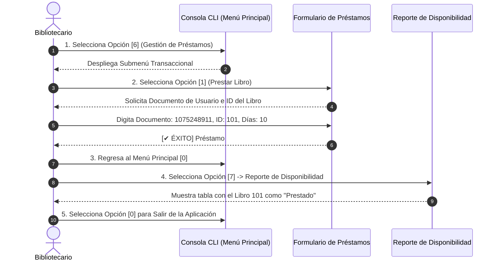

# FASE 5: MOCKUP, PROTOTIPO Y FLUJOS DE NAVEGACIÓN
## Sistema de Biblioteca Digital (CLI MVP)

> **Programa:** Análisis y Desarrollo de Software (ADSO) — SENA  
> **Ficha:** 3239188 | **Centro:** Centro de la Industria, la Empresa y los Servicios (CIES) — Neiva  
> **Instructor Técnico:** Carlos Julio Cadena  
> **Equipo 08:** Juan David Romero Calderón, Juan Diego Oteca Pedreros, Jhojan Javier Melo Avella  

---

## 1. Introducción y Propósito del Prototipado

La **Fase 5** materializa la experiencia de usuario (UX) y el diseño de interacción de la interfaz de consola de comandos (**CLI - Command Line Interface**) antes de abordar la fase final de programación.

El objetivo central es validar:
- La jerarquía y navegabilidad entre menús y submenús.
- La disposición y captura guiada de formularios.
- El formato tabular de salida para reportes y listados.
- La retroalimentación visual inmediata ante aciertos y errores (mensajes de validación de reglas de negocio RN-01 a RN-05).

> [!NOTE]
> **Alcance de Acceso (HU-12):** En conformidad con la priorización MoSCoW del MVP, el software opera en una terminal monousuario centralizada para el rol **Bibliotecario**, por lo cual la pantalla de Login con contraseñas queda formalmente excluida de esta versión.

---

## 2. Mapa y Estructura de Navegación del Sistema

El siguiente diagrama modela el árbol de navegación completo de la interfaz de consola:

```mermaid
flowchart TD
    Inicio([Inicio del Sistema]) --> MenuPrincipal[Menú Principal del Sistema]
    
    MenuPrincipal --> Op1[1. Registrar Nuevo Libro]
    MenuPrincipal --> Op2[2. Buscar Libro por ID]
    MenuPrincipal --> Op3[3. Buscar Libro por Título o Autor]
    MenuPrincipal --> Op4[4. Modificar Libro Existente]
    MenuPrincipal --> Op5[5. Eliminar Libro del Catálogo]
    MenuPrincipal --> Op6[6. Gestión de Préstamos y Devoluciones]
    MenuPrincipal --> Op7[7. Módulo de Reportes Rápidos]
    MenuPrincipal --> Op0[0. Salir de la Aplicación]

    %% Flujos de Gestión Transaccional
    Op6 --> SubmenuPrestamos{Submenú Transacciones}
    SubmenuPrestamos --> SP1[1. Registrar Salida: Prestar Libro]
    SubmenuPrestamos --> SP2[2. Registrar Entrada: Devolución]
    SubmenuPrestamos --> SP3[3. Consultar Disponibilidad de Ejemplar]
    SubmenuPrestamos --> SP0[0. Volver al Menú Principal]
    SP0 --> MenuPrincipal

    %% Flujos de Reportes
    Op7 --> SubmenuReportes{Submenú de Reportes}
    SubmenuReportes --> SR1[1. Listado General de Libros]
    SubmenuReportes --> SR2[2. Listado de Libros Disponibles]
    SubmenuReportes --> SR3[3. Listado de Libros Prestados]
    SubmenuReportes --> SR0[0. Volver al Menú Principal]
    SR0 --> MenuPrincipal

    %% Retornos
    Op1 --> Ret1[Confirmación / Alerta] --> MenuPrincipal
    Op2 --> Ret2[Ficha de Detalle] --> MenuPrincipal
    Op3 --> Ret3[Tabla de Coincidencias] --> MenuPrincipal
    Op4 --> Ret4[Confirmación Edición] --> MenuPrincipal
    Op5 --> Ret5[Confirmación / Bloqueo] --> MenuPrincipal
    SP1 --> MenuPrincipal
    SP2 --> MenuPrincipal
    SP3 --> MenuPrincipal
    SR1 --> MenuPrincipal
    SR2 --> MenuPrincipal
    SR3 --> MenuPrincipal
    Op0 --> Fin([Fin de la Sesión])
```



---

## 3. Wireframes de Pantalla de Inicio y Dashboard Principal

### 3.1. Pantalla de Bienvenida y Dashboard CLI
Esta es la vista raíz que recibe al bibliotecario al iniciar la aplicación:

```text
================================================================================
          SISTEMA DE GESTIÓN DE BIBLIOTECA DIGITAL — CIES NEIVA
                             (MVP - VERSIÓN 1.0)
================================================================================
 Operador Activo: Bibliotecario de Turno | Fecha del Sistema: 2026-10-25
--------------------------------------------------------------------------------
 [1] Registrar nuevo libro en catálogo
 [2] Buscar libro por ID
 [3] Buscar libros por Título o Autor
 [4] Modificar datos de libro
 [5] Eliminar libro del catálogo (Baja física)
 [6] Gestión de Préstamos y Devoluciones (Transacciones)
 [7] Módulo de Reportes y Listados
 [0] Salir del sistema
================================================================================
 Ingrese una opción numérica (0-7): _
```

---

## 4. Wireframes de Formularios de Captura de Datos

### 4.1. Formulario 1: Registrar Libro (HU-01 / RF-01)
Captura secuencial de atributos unificados con validaciones en línea:

```text
--------------------------------------------------------------------------------
                     FORMULARIO: REGISTRO DE NUEVO LIBRO
--------------------------------------------------------------------------------
 Ingrese ID numérico del libro: 101
 Ingrese Título: Cien años de soledad
 Ingrese Identificador del Autor (ORCID/ISNI): 0000-0002-1825-0097
 Ingrese Año de Publicación: 1967
 Ingrese Código ISBN: 978-0307474728
 Ingrese Categoría temática: Novela y Ficción
--------------------------------------------------------------------------------
 [SISTEMA] Validando unicidad de ISBN y existencia de Autor...
 [✔ ÉXITO] Libro registrado correctamente en el catálogo con estado: DISPONIBLE.
 Presione ENTER para continuar...
```

---

### 4.2. Formulario 2: Registrar Autor (HU-02 / RF-02)
Formulario invocado al catalogar un autor nuevo:

```text
--------------------------------------------------------------------------------
                     FORMULARIO: REGISTRO DE AUTOR
--------------------------------------------------------------------------------
 Ingrese Código Normalizado (ORCID/ISNI): 0000-0002-1825-0097
 Ingrese Nombre Completo: Gabriel García Márquez
 Ingrese Nacionalidad: Colombiana
--------------------------------------------------------------------------------
 [SISTEMA] Validando unicidad de identificador (RN-02)...
 [✔ ÉXITO] Autor registrado correctamente en la base de datos de autores.
 Presione ENTER para continuar...
```

---

### 4.3. Formulario 3: Registrar Usuario (HU-03 / RF-03)
Alta de prestatario con validación de documento único:

```text
--------------------------------------------------------------------------------
                     FORMULARIO: ALTA DE USUARIO PRESTATARIO
--------------------------------------------------------------------------------
 Ingrese Número de Documento de Identidad: 1075248911
 Ingrese Nombre Completo: Juan David Romero Calderón
 Ingrese Número Telefónico: 3124567890
--------------------------------------------------------------------------------
 [SISTEMA] Validando documento (RN-03)...
 [✔ ÉXITO] Usuario registrado exitosamente con estado: ACTIVO.
 Presione ENTER para continuar...
```

---

### 4.4. Formulario 4: Prestar Libro (HU-05 / RF-05)
Captura transaccional de préstamo validando usuario activo y ejemplar disponible:

```text
--------------------------------------------------------------------------------
                 TRANSACCIÓN: PRÉSTAMO DE MATERIAL BIBLIOGRÁFICO
--------------------------------------------------------------------------------
 Ingrese Documento del Usuario Solicitante: 1075248911
 [✔] Usuario localizado: Juan David Romero Calderón | Estado: ACTIVO

 Ingrese ID del Libro a Prestar: 101
 [✔] Libro localizado: "Cien años de soledad" | Estado: DISPONIBLE

 Ingrese Días de Préstamo pactados (1-30): 10
--------------------------------------------------------------------------------
 [SISTEMA] Calculando fecha límite: 2026-11-04...
 [SISTEMA] Actualizando estado del libro a NO DISPONIBLE...
 [✔ ÉXITO] Préstamo registrado exitosamente. (Préstamo # 1001)
 Presione ENTER para continuar...
```

---

### 4.5. Formulario 5: Registrar Devolución (HU-06 / RF-06)
Reintegro de material y control de entrega a tiempo o tardía:

```text
--------------------------------------------------------------------------------
                 TRANSACCIÓN: REGISTRO DE DEVOLUCIÓN FÍSICA
--------------------------------------------------------------------------------
 Ingrese ID del Préstamo o ID del Libro: 1001
 [✔] Préstamo Activo Encontrado:
     - Libro: "Cien años de soledad" (ID: 101)
     - Usuario: Juan David Romero Calderón (Doc: 1075248911)
     - Fecha Préstamo: 2026-10-25 | Fecha Límite Pactada: 2026-11-04
     - Fecha Actual del Sistema: 2026-11-01
--------------------------------------------------------------------------------
 Confirmar recepción física del ejemplar (S/N): S
 [SISTEMA] Validando fechas...
 [✔ ÉXITO] Devolución registrada a tiempo. Préstamo cerrado y libro DISPONIBLE.
 Presione ENTER para continuar...
```

---

## 5. Wireframes de Listados, Búsquedas y Reportes

### 5.1. Consulta Rápida de Disponibilidad (HU-04 / RF-04)

```text
--------------------------------------------------------------------------------
                    CONSULTA DE DISPONIBILIDAD DE EJEMPLAR
--------------------------------------------------------------------------------
 Ingrese ID o Título del libro a consultar: Cien años de soledad

 [FICHA DE DISPONIBILIDAD]
  ID: 101
  Título: Cien años de soledad
  ISBN: 978-0307474728
  Autor: Gabriel García Márquez
  Categoría: Novela y Ficción
  ESTADO ACTUAL: [ NO DISPONIBLE - EN PRÉSTAMO ]
  Fecha Estimada de Devolución: 2026-11-04
  Responsable: Juan David Romero Calderón (Tel: 3124567890)
--------------------------------------------------------------------------------
 Presione ENTER para volver...
```

---

### 5.2. Búsqueda por Título o Autor (HU-07 / RF-07)
Formato de tabla con encabezados y alineación uniforme:

```text
--------------------------------------------------------------------------------
                  RESULTADOS DE BÚSQUEDA: "García"
--------------------------------------------------------------------------------
 ID   | ISBN            | TÍTULO                    | AUTOR            | ESTADO
------+-----------------+---------------------------+------------------+----------
 101  | 978-0307474728  | Cien años de soledad      | G. García M.     | Prestado
 104  | 978-0307387738  | El amor en tiempos cólera | G. García M.     | Disponible
 108  | 978-9580424567  | Crónica de muerte anunci. | G. García M.     | Disponible
--------------------------------------------------------------------------------
 Total de coincidencias encontradas: 3
 Presione ENTER para volver...
```

---

### 5.3. Reporte de Préstamos Activos (HU-09 / Submenú 7)

```text
================================================================================
                    REPORTE GENERAL: PRÉSTAMOS ACTIVOS EN CURSO
================================================================================
 ID P. | TÍTULO DEL LIBRO          | PRESTATARIO       | EMISIÓN    | VENCE
-------+---------------------------+-------------------+------------+------------
 1001  | Cien años de soledad      | Juan David Romero | 2026-10-25 | 2026-11-04
 1002  | Clean Code                | Juan Diego Oteca  | 2026-10-20 | 2026-10-30
 1003  | Don Quijote de la Mancha  | Jhojan Melo       | 2026-10-18 | 2026-10-28
================================================================================
 Préstamos Vigentes: 3 | Préstamos Vencidos: 0
 Presione ENTER para volver...
```

---

## 6. Catálogo Visual de Mensajes de Validación y Error

Para cumplir con el estándar **RNF-03 (Usabilidad)** y **RNF-02 (Confiabilidad)**, el sistema maneja plantillas gráficas estandarizadas para evitar cierres abruptos:

| Tipo | Evento / Regla | Representación Visual en Consola CLI |
| :---: | :--- | :--- |
| **Error** | ISBN Duplicado (RN-01) | `[✖ ERROR - RN-01]: Registro ISBN existente. La operación fue cancelada.` |
| **Error** | Autor Duplicado (RN-02) | `[✖ ERROR - RN-02]: Este identificador ya se encuentra registrado para otro autor.` |
| **Error** | Documento Duplicado (RN-03) | `[✖ ERROR - RN-03]: Este documento ya se encuentra registrado en el sistema.` |
| **Error** | Usuario Inactivo (RN-04) | `[✖ ERROR - RN-04]: Usuario no habilitado para préstamos. Estado actual: INACTIVO.` |
| **Error** | Eliminación Denegada (RN-05) | `[✖ ERROR - RN-05]: No se puede eliminar un libro que tiene un préstamo activo.` |
| **Error** | Campo Vacío (CA-2) | `[✖ VALIDACIÓN]: Campo obligatorio. No puede dejar este valor en blanco.` |
| **Alerta** | Devolución Tardía (HU-06) | `[⚠ ADVERTENCIA]: Devolución registrada con retraso. Plazo vencido el 2026-10-20.` |
| **Éxito** | Transacción OK | `[✔ ÉXITO]: Operación procesada y confirmada en memoria.` |

---

## 7. Simulación de Recorrido del Prototipo Navegable (User Journey)

El flujo típico de operación del bibliotecario se valida en 5 pasos secuenciales:



---
*Fin de la documentación de diseño y prototipado — Aprobada para construcción en Fase 6.*
