# FASE 5: MOCKUP, PROTOTIPO Y FLUJOS DE NAVEGACIÓN
## Sistema de Biblioteca Digital (CLI MVP y Prototipo)

> **Programa:** Análisis y Desarrollo de Software (ADSO) — SENA  
> **Ficha:** 3239188 | **Centro:** Centro de la Industria, la Empresa y los Servicios (CIES) — Neiva  
> **Instructor Técnico:** Carlos Julio Cadena  
> **Equipo 08:** Juan David Romero Calderón, Juan Diego Oteca Pedreros, Jhojan Javier Melo Avella  

---

## 1. Introducción y Propósito del Prototipado

La **Fase 5** materializa la experiencia de usuario (UX) y el diseño de interacción de la interfaz de consola de comandos (**CLI - Command Line Interface**) y prototipo navegable antes de abordar la fase final de programación.

El objetivo central es validar:
- La jerarquía y navegabilidad entre menús y submenús con migas de pan textuales (**Breadcrumbs**).
- La captura asistida y búsqueda guiada de relaciones (eliminando la fricción de memorizar códigos ISNI o IDs numéricos).
- El formato tabular de salida para reportes y listados con anchos dinámicos y elipsis formales.
- La paleta de secuencias de escape ANSI de alto contraste conforme a principios de accesibilidad.
- La retroalimentación visual inmediata ante aciertos y errores (mensajes de validación de reglas de negocio RN-01 a RN-05).

> [!NOTE]
> **Alcance de Acceso (HU-12):** En conformidad con la priorización MoSCoW del MVP, el software opera en una terminal monousuario centralizada para el rol **Bibliotecario**, por lo cual la pantalla de Login con contraseñas queda formalmente excluida de esta versión.

---

## 2. Mapa y Estructura de Navegación del Sistema

El siguiente diagrama modela el árbol de navegación completo de la interfaz de consola:

```mermaid
flowchart TD
    Inicio([Inicio del Sistema]) --> MenuPrincipal[Menú Principal del Sistema]
    
    MenuPrincipal --> Op1[1. Registrar Nuevo Libro]
    MenuPrincipal --> Op2[2. Registrar Nuevo Autor]
    MenuPrincipal --> Op3[3. Registrar Nuevo Usuario]
    MenuPrincipal --> Op4[4. Buscar Libro por ID]
    MenuPrincipal --> Op5[5. Buscar Libros por Título o Autor]
    MenuPrincipal --> Op6[6. Modificar Libro Existente]
    MenuPrincipal --> Op7[7. Dar de Baja Libro - Baja Lógica]
    MenuPrincipal --> Op8[8. Gestión de Préstamos y Devoluciones]
    MenuPrincipal --> Op9[9. Módulo de Reportes Rápidos]
    MenuPrincipal --> Op0[0. Salir de la Aplicación]

    %% Flujos de Gestión Transaccional
    Op8 --> SubmenuPrestamos{Submenú Transacciones}
    SubmenuPrestamos --> SP1[1. Registrar Salida: Prestar Libro]
    SubmenuPrestamos --> SP2[2. Registrar Entrada: Devolución]
    SubmenuPrestamos --> SP3[3. Consultar Disponibilidad de Ejemplar]
    SubmenuPrestamos --> SP0[0. Volver al Menú Principal]
    SP0 --> MenuPrincipal

    %% Flujos de Reportes
    Op9 --> SubmenuReportes{Submenú de Reportes}
    SubmenuReportes --> SR1[1. Listado General Activo]
    SubmenuReportes --> SR2[2. Listado de Libros Disponibles]
    SubmenuReportes --> SR3[3. Listado de Préstamos en Curso y Vencidos]
    SubmenuReportes --> SR0[0. Volver al Menú Principal]
    SR0 --> MenuPrincipal

    %% Retornos
    Op1 --> Ret1[Confirmación / Alerta] --> MenuPrincipal
    Op2 --> Ret2[Confirmación Autor] --> MenuPrincipal
    Op3 --> Ret3[Confirmación Usuario] --> MenuPrincipal
    Op4 --> Ret4[Ficha de Detalle] --> MenuPrincipal
    Op5 --> Ret5[Tabla de Coincidencias] --> MenuPrincipal
    Op6 --> Ret6[Confirmación Edición] --> MenuPrincipal
    Op7 --> Ret7[Confirmación Baja Lógica] --> MenuPrincipal
    SP1 --> MenuPrincipal
    SP2 --> MenuPrincipal
    SP3 --> MenuPrincipal
    SR1 --> MenuPrincipal
    SR2 --> MenuPrincipal
    SR3 --> MenuPrincipal
    Op0 --> Fin([Fin de la Sesión])
```



---

## 3. Wireframes de Pantalla de Inicio y Dashboard Principal

### 3.1. Pantalla de Bienvenida y Dashboard CLI
Esta es la vista raíz que recibe al bibliotecario al iniciar la aplicación:

```text
================================================================================
          SISTEMA DE GESTIÓN DE BIBLIOTECA DIGITAL — CIES NEIVA
                             (MVP - VERSIÓN 1.0)
================================================================================
 Operador Activo: Bibliotecario de Turno | Fecha del Sistema: 2026-10-25
--------------------------------------------------------------------------------
 [1] Registrar nuevo libro en catálogo
 [2] Registrar nuevo autor
 [3] Registrar nuevo usuario prestatario
 [4] Buscar libro por ID
 [5] Buscar libros por Título o Autor
 [6] Modificar datos de libro
 [7] Dar de baja libro del catálogo (Baja lógica)
 [8] Gestión de Préstamos y Devoluciones (Transacciones)
 [9] Módulo de Reportes y Listados
 [0] Salir del sistema
================================================================================
 Ingrese una opción numérica (0-9): _
```

---

## 4. Wireframes de Formularios de Captura de Datos Asistida (Obs 01 & Obs 03)

### 4.1. Formulario 1: Registrar Libro (HU-01 / RF-01)
Incorpora búsqueda asistida de autores mediante el comodín `?` para eliminar la fricción de digitar códigos ISNI largos de 16 dígitos:

```text
================================================================================
Ruta: Menú Principal > [1] Registrar Nuevo Libro en Catálogo
[Presione 0 o ESC para cancelar y regresar]
================================================================================
 Ingrese ID numérico del libro: 101
 Ingrese Título: Cien años de soledad
 Ingrese Identificador del Autor (ISNI o '?' para buscar): ?
 >> Búsqueda asistida de autores:
    [1] Gabriel García Márquez (ISNI: 0000-0001-2141-4109)
    [2] Robert C. Martin (ISNI: 0000-0002-1825-0097)
    [3] Miguel de Cervantes Saavedra (ISNI: 0000-0001-9287-3421)
 Seleccione autor (1..N): 1
 [✔] Autor asociado: Gabriel García Márquez
 Ingrese Año de Publicación (1000-2026): 1967
 Ingrese Código ISBN (10 o 13 dígitos): 978-0307474728
 Ingrese Categoría temática: Novela y Ficción
--------------------------------------------------------------------------------
 [SISTEMA] Validando unicidad de ISBN (RN-01) y FK de Autor...
 [✔ ÉXITO] Libro registrado correctamente en el catálogo con estado: DISPONIBLE.
 Presione ENTER para continuar...
```

---

### 4.2. Formulario 2: Registrar Autor (HU-02 / RF-02)
Formulario invocado al catalogar un autor nuevo con validación estructural:

```text
================================================================================
Ruta: Menú Principal > [2] Registrar Nuevo Autor
[Presione 0 o ESC para cancelar y regresar]
================================================================================
 Ingrese Código Normalizado (ISNI / ORCID): 0000-0001-2141-4109
 Ingrese Nombre Completo del Autor: Gabriel García Márquez
 Ingrese Nacionalidad: Colombiana
--------------------------------------------------------------------------------
 [SISTEMA] Validando unicidad de identificador (RN-02)...
 [✔ ÉXITO] Autor registrado correctamente en la base de datos de autores.
 Presione ENTER para continuar...
```

---

### 4.3. Formulario 3: Registrar Usuario (HU-03 / RF-03)
Alta de prestatario con validación de documento único y teléfono de 10 dígitos:

```text
================================================================================
Ruta: Menú Principal > [3] Registrar Nuevo Usuario Prestatario
[Presione 0 o ESC para cancelar y regresar]
================================================================================
 Ingrese Número de Documento de Identidad (6-15 dígitos): 1075248911
 Ingrese Nombre Completo: Juan David Romero Calderón
 Ingrese Número Telefónico (10 dígitos): 3124567890
--------------------------------------------------------------------------------
 [SISTEMA] Validando documento (RN-03)...
 [✔ ÉXITO] Usuario registrado exitosamente con estado: ACTIVO.
 Presione ENTER para continuar...
```

---

### 4.4. Formulario 4: Prestar Libro Asistido (HU-05 / RF-05 / Obs 01 & 03)
Captura transaccional de préstamo con búsqueda guiada de lectores y títulos:

```text
================================================================================
Ruta: Menú Principal > [8] Gestión de Préstamos > [1] Registrar Salida (Préstamo)
[Presione 0 o ESC para cancelar y regresar]
================================================================================
 Ingrese Documento o Nombre del Lector: David
 >> Coincidencias encontradas:
    [1] Juan David Romero Calderón (Doc: 1075248911 | Estado: ACTIVO)
 Seleccione lector (1..N): 1
 [✔] Lector seleccionado: Juan David Romero Calderón | Estado: HABILITADO

 Ingrese ID, Título o ISBN del Libro a Prestar: Cien
 >> Coincidencias encontradas:
    [1] [#101] Cien años de soledad — G. García Márquez (DISPONIBLE)
 Seleccione ejemplar (1..N): 1
 [✔] Libro seleccionado: "Cien años de soledad" | Estado: DISPONIBLE

 Ingrese Días de Préstamo pactados (1-30) [Por defecto: 14]: 14
--------------------------------------------------------------------------------
 [SISTEMA] Calculando fecha límite: 2026-11-08...
 [SISTEMA] Actualizando estado del libro a NO DISPONIBLE...
 [✔ ÉXITO] Préstamo #1001 registrado exitosamente.
 Presione ENTER para continuar...
```

---

### 4.5. Formulario 5: Registrar Devolución (HU-06 / RF-06)
Reintegro de material y control de entrega a tiempo o tardía:

```text
================================================================================
Ruta: Menú Principal > [8] Gestión de Préstamos > [2] Registrar Devolución Física
[Presione 0 o ESC para cancelar y regresar]
================================================================================
 Ingrese ID del Préstamo o ID del Libro: 1001
 [✔] Préstamo Activo Encontrado:
     - Libro: "Cien años de soledad" (ID: 101)
     - Usuario: Juan David Romero Calderón (Doc: 1075248911)
     - Fecha Préstamo: 2026-10-25 | Fecha Límite Pactada: 2026-11-08
     - Fecha Actual del Sistema: 2026-11-01
--------------------------------------------------------------------------------
 Confirmar recepción física del ejemplar (S/N): S
 [SISTEMA] Validando fechas...
 [✔ ÉXITO] Devolución registrada a tiempo. Préstamo cerrado y libro DISPONIBLE.
 Presione ENTER para continuar...
```

---

## 5. Wireframes de Listados, Búsquedas y Reportes (Obs 05: Formato Tabular Dinámico)

### 5.1. Consulta Rápida de Disponibilidad (HU-04 / RF-04)

```text
================================================================================
Ruta: Menú Principal > [4] Buscar Libro por ID / Disponibilidad
[Presione 0 o ESC para volver]
================================================================================
 Ingrese ID numérico o título del libro: Cien años de soledad

 [FICHA TÉCNICA DEL EJEMPLAR]
  ID Numérico: 101
  Título de la Obra: Cien años de soledad
  Código ISBN: 978-0307474728
  Autor Maestro: Gabriel García Márquez (Colombiana)
  Categoría Temática: Novela y Ficción
  ESTADO DE DISPONIBILIDAD: [ NO DISPONIBLE - EN PRÉSTAMO ACTIVO ]
  Fecha Límite Pactada de Devolución: 2026-11-08
  Lector Asignado: Juan David Romero Calderón (Tel: 3124567890)
--------------------------------------------------------------------------------
 Presione ENTER para volver...
```

---

### 5.2. Búsqueda por Título o Autor con Elipsis Formal (HU-07 / RF-07 / Obs 05)
Las tablas de salida utilizan formato tabulado con ancho dinámico (`printf`) y punto suspensivo formal (`...`) para evitar cortes antiestéticos en títulos extensos:

```text
================================================================================
Ruta: Menú Principal > [5] Búsqueda por Título o Autor (Coincidencia Parcial)
================================================================================
 Criterio de búsqueda: "García"
--------------------------------------------------------------------------------
 ID   | ISBN            | TÍTULO DE LA OBRA              | AUTOR            | ESTADO
------+-----------------+--------------------------------+------------------+------------
 101  | 978-0307474728  | Cien años de soledad           | G. García M.     | Prestado
 104  | 978-0307387738  | El amor en los tiempos del ... | G. García M.     | Disponible
 108  | 978-9580424567  | Crónica de una muerte anunc... | G. García M.     | Disponible
--------------------------------------------------------------------------------
 Total de coincidencias encontradas: 3 registros activos.
 Presione ENTER para volver al menú principal...
```

---

### 5.3. Reporte de Préstamos Activos y Alertas de Vencimiento (HU-09 / Obs 12)

```text
================================================================================
Ruta: Menú Principal > [9] Módulo de Reportes > [3] Préstamos Activos y Vencidos
================================================================================
 ID P. | TÍTULO DEL LIBRO               | PRESTATARIO       | EMISIÓN    | VENCE      | ESTADO
-------+--------------------------------+-------------------+------------+------------+-----------
 1001  | Cien años de soledad           | Juan David Romero | 2026-10-25 | 2026-11-08 | En Curso
 1002  | Clean Code: Manual de Desar... | Juan Diego Oteca  | 2026-10-15 | 2026-10-29 | VENCIDO ⚠
 1003  | Don Quijote de la Mancha       | Jhojan Melo       | 2026-10-18 | 2026-10-28 | VENCIDO ⚠
================================================================================
 Resumen: Préstamos en Curso: 1 | ⚠ Préstamos en Mora: 2 (Requieren gestión)
 Presione ENTER para volver...
```

---

## 6. Catálogo Visual de Mensajes de Validación y Error

Para cumplir con el estándar **RNF-03 (Usabilidad)** y **RNF-02 (Confiabilidad)**, el sistema maneja plantillas gráficas estandarizadas para evitar cierres abruptos:

| Tipo | Evento / Regla | Representación Visual en Consola CLI |
| :---: | :--- | :--- |
| **Error** | ISBN Duplicado (RN-01) | `[✖ ERROR]: El código ISBN ya se encuentra registrado en el catálogo.` |
| **Error** | Autor Duplicado (RN-02) | `[✖ ERROR]: Este identificador ya pertenece a otro autor en el sistema.` |
| **Error** | Documento Duplicado (RN-03) | `[✖ ERROR]: Este documento ya pertenece a un usuario prestatario registrado.` |
| **Error** | Usuario Inactivo (RN-04) | `[✖ ERROR]: Usuario no habilitado para préstamos. Estado actual: INACTIVO.` |
| **Error** | Eliminación Denegada (RN-05) | `[✖ ERROR]: Operación rechazada: No se puede dar de baja un ejemplar con préstamo activo.` |
| **Error** | Campo Vacío (CA-2) | `[✖ VALIDACIÓN]: Campo obligatorio. Diligencie la información requerida.` |
| **Alerta** | Devolución Tardía (HU-06) | `[⚠ ADVERTENCIA]: Devolución registrada con retraso. Plazo vencido.` |
| **Alerta** | Préstamo por Vencer | `[⚠ ATENCIÓN]: El préstamo vence en las próximas 48 horas.` |
| **Éxito** | Transacción OK | `[✔ ÉXITO]: Operación procesada y confirmada en memoria.` |

---

## 7. Estándar de Colores ANSI y Accesibilidad en Consola (Obs 02)

Para garantizar la legibilidad en emuladores de terminal tanto en esquemas oscuros como claros (WCAG aplicado a CLI):

| Elemento CLI | Secuencia ANSI | Color Resultante | Propósito de Accesibilidad |
| :--- | :--- | :--- | :--- |
| **Encabezados / Títulos** | `\033[1;33m` | Amarillo / Ámbar Brillante | Alta visibilidad en fondos oscuros y negros. |
| **Breadcrumbs / Rutas** | `\033[1;36m` | Cian Claro | Distingue la ubicación jerárquica sin competir con el título. |
| **Aciertos / Confirmación** | `\033[1;32m` | Verde Esmeralda | Acompañado siempre del glifo textual `[✔ ÉXITO]`. |
| **Alertas / Advertencias** | `\033[1;33m` | Amarillo Ocre | Acompañado del símbolo `[⚠ ADVERTENCIA]`. |
| **Errores / Denegaciones** | `\033[1;31m` | Rojo Fuego | Acompañado del símbolo `[✖ ERROR]`. |
| **Etiquetas Muted / Ayuda** | `\033[90m` | Gris Neutro | Textos de guía `[ESC para volver]` sin fatiga visual. |
| **Restablecer Estilos** | `\033[0m` | Reset Estándar | Cierra cualquier secuencia tras emitir el mensaje. |

---

## 8. Simulación de Recorrido del Prototipo Navegable (User Journey)

El flujo típico de operación del bibliotecario se valida en 5 pasos secuenciales:

```mermaid
sequenceDiagram
    autonumber
    actor B as Bibliotecario
    participant CLI as Consola CLI (Menú Principal)
    participant F as Formulario de Préstamos
    participant R as Reporte de Disponibilidad

    B ->> CLI: 1. Selecciona Opción [8] (Gestión de Préstamos)
    CLI -->> B: Despliega Submenú Transaccional con Breadcrumb
    B ->> F: 2. Selecciona Opción [1] (Prestar Libro)
    F -->> B: Solicita Lector (Búsqueda asistida) y Libro
    B ->> F: Digita "David", selecciona [1]; digita "Cien", selecciona [1]
    F -->> B: [✔ ÉXITO] Préstamo #1001 Registrado. Libro pasa a NO DISPONIBLE.
    B ->> CLI: 3. Regresa al Menú Principal [0]
    B ->> R: 4. Selecciona Opción [9] -> Reporte de Disponibilidad
    R -->> B: Muestra tabla con el Libro 101 como "Prestado"
    B ->> CLI: 5. Selecciona Opción [0] para Salir de la Aplicación
```

---
*Fin de la especificación técnica de prototipado y experiencia de usuario CLI — Ajustado según observaciones de auditoría técnica.*
