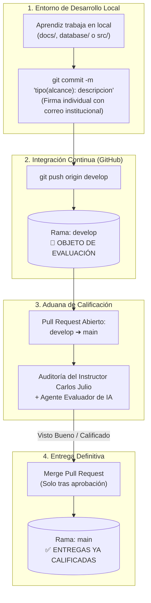

# ⚖️ REGLAS DE GOBIERNO EN GIT, FLUJO DE RAMAS Y ADUANA DE EVALUACIÓN
## Módulo 01 — Protocolo de Integración y Calificación Docente

> **Programa:** Análisis y Desarrollo de Software (ADSO) — SENA Ficha 3239188  
> **Instructor Técnico:** Carlos Julio Cadena  
> **Equipo 08:** Juan David Romero Calderón, Juan Diego Oteca Pedreros, Jhojan Javier Melo Avella  

---

## 🎯 1. Instrucción de Evaluación para el Instructor y Agente de IA

- **Rama de Evaluación Activa (`develop`):** Esta es la rama que contiene el incremento más reciente, la resolución de observaciones técnicas y la documentación integral de las **Fases 1 a la 5** junto con el script de base de datos relacional. **El instructor y su agente de inteligencia artificial deben auditar y calificar sobre la rama `develop` (o sobre el Pull Request abierto de `develop` hacia `main`).**
- **Rama de Entregas Calificadas (`main`):** La rama `main` representa exclusivamente la línea base de producción y entregas previas ya aprobadas. **Ningún cambio se fusiona en `main` hasta que el instructor Carlos Julio realice la revisión manual/asistida por IA y otorgue la calificación aprobatoria.**

---

## 🔄 2. Flujo de Trabajo y Aduana de Calificación

El siguiente diagrama detalla el ciclo de vida de los cambios desde el computador de cada aprendiz hasta la entrega final aprobada:



---

## 🌿 3. Política Estricta de Ramas

### `main` (Rama de Producción / Entregas Calificadas):
- **Prohibición absoluta:** Ningún miembro del equipo puede hacer `git push` directo o commits manuales sobre `main`.
- Contiene exclusivamente versiones que ya han sido revisadas, sustentadas y calificadas por el instructor técnico.

### `develop` (Rama de Desarrollo Activo y Calificación):
- Es la rama central de trabajo colaborativo donde se integran los avances de las fases y código.
- **Es la rama que el instructor Carlos Julio y el agente de IA evalúan.**

### Ramas de Características (`feature/*` o `docs/*`):
- Ramas auxiliares utilizadas por los aprendices para desarrollar módulos específicos o maquetar documentos antes de integrarlos a `develop`.

---

## 🔒 4. Protocolo Obligatorio de Entrega mediante Pull Request (PR)

1. Los aprendices finalizan los cambios en la rama `develop` y ejecutan `git push origin develop`.
2. Se abre un **Pull Request** en GitHub con la configuración:
   $$\text{Base: } \mathbf{main} \quad \longleftarrow \quad \text{Compare: } \mathbf{develop}$$
3. El Pull Request documenta el resumen técnico de las historias, requisitos o esquemas desarrollados.
4. **El PR se mantiene ABIERTO** para que el instructor Carlos Julio (manualmente o con asistencia de IA) audite las diferencias en la pestaña *Files Changed*.
5. **Fusión (*Merge*):** Solo se hace clic en **Merge Pull Request** una vez que el instructor emite la retroalimentación y aprueba la entrega con calificación aprobatoria.

---

## ⚡ 5. Regla de Sincronización Previa (`git pull`)

Para evitar conflictos de fusión (*merge conflicts*), cada desarrollador debe ejecutar obligatoriamente antes de iniciar su jornada de trabajo:
```powershell
git checkout develop
git pull origin develop
```
