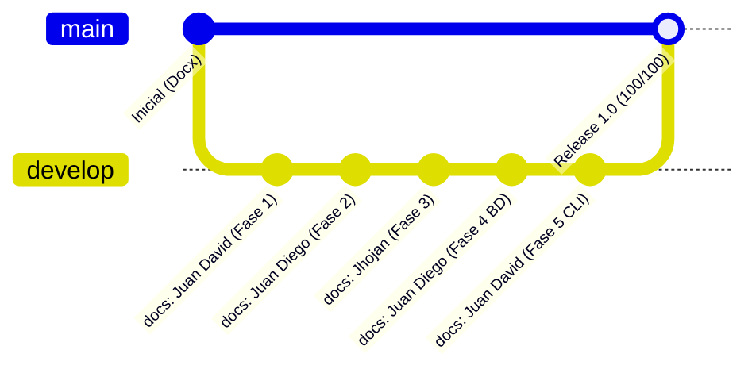

# 🛠️ GUÍA DE TRABAJO COLABORATIVO EN GIT Y ASIGNACIÓN DE TAREAS
## Sistema de Biblioteca Digital — SENA Ficha 3239188

> **Instructor Técnico:** Carlos Julio Cadena  
> **Objetivo:** Establecer una disciplina profesional de control de versiones con Git, eliminando malas prácticas (subidas web o commits directos a `main`) y garantizando que **todos los integrantes del equipo registren commits individuales y comprobables** en GitHub.

---

## 📌 1. Principio Fundamental: Modelo de Ramas (GitFlow)

En la industria del software y en las evaluaciones de ingeniería, commitear directamente a la rama `main` es una **mala práctica crítica**.



- **`main`:** Es la rama de producción o entrega final evaluable. Solo recibe fusiones (merges o Pull Requests) aprobados.
- **`develop`:** Es la rama de trabajo diario donde se consolidan los cambios documentales y técnicos.

---

## 👥 2. Matriz de Asignación de Tareas por Integrante

Para que el instructor Carlos Julio evidencie el aporte equitativo en la pestaña **Insights / Contributors** de GitHub, cada aprendiz tiene asignada una responsabilidad documental:

| Integrante | Rol | Archivo Principal Asignado | Tipo de Commit Convencional |
| :--- | :--- | :--- | :--- |
| **Juan David Romero** | Líder / Product Owner | `README.md`<br>`docs/fase1_historias_usuario.md`<br>`docs/fase5_mockup_prototipo.md`<br>`.gitignore` | `docs(fase1): estructurar historias de usuario y matriz moscow`<br>`docs(fase5): modelar prototipo interactivo cli y navegacion` |
| **Juan Diego Oteca** | Analista de Requerimientos y Datos | `docs/fase2_especificacion_requerimientos_ieee830.md`<br>`docs/fase4_base_de_datos.md`<br>`database/schema.sql` | `docs(fase2): formalizar especificacion requerimientos ieee 830`<br>`feat(fase4-sql): implementar esquema relacional 3fn y seed data` |
| **Jhojan Javier Melo** | Diseñador de Software y UML | `docs/fase3_diseno_uml.md`<br>`docs/guia_git_equipo.md` | `docs(fase3): modelar diagramas uml con sintaxis mermaid` |

---

## 💻 3. Paso a Paso para Trabajar y Registrar Commits Individuales

Cada integrante debe ejecutar estos pasos desde su propio computador o terminal para asegurar que su nombre y correo institucional queden grabados en el historial de Git.

---

### 👤 Paso 3.1: Configurar Identidad de Git (Una sola vez por máquina)

Abre la terminal (PowerShell o Git Bash) y ejecuta con **tus datos reales**:

#### Si eres Juan David Romero:
```powershell
git config --global user.name "Juan David Romero Calderon"
git config --global user.email "tu_correo_de_github_o_misena@misena.edu.co"
```

#### Si eres Juan Diego Oteca:
```powershell
git config --global user.name "Juan Diego Oteca Pedreros"
git config --global user.email "tu_correo_de_github_o_misena@misena.edu.co"
```

#### Si eres Jhojan Javier Melo:
```powershell
git config --global user.name "Jhojan Javier Melo Avella"
git config --global user.email "tu_correo_de_github_o_misena@misena.edu.co"
```

*Verifica tu configuración con:*
```powershell
git config user.name
git config user.email
```

---

### 📥 Paso 3.2: Clonar o Actualizar el Repositorio

Si aún no tienes el proyecto en tu máquina:
```powershell
git clone https://github.com/JuacHomeroC12/Gestion-de-biblioteca-virtual-.git
cd Gestion-de-biblioteca-virtual-
```

Si ya lo tienes clonado, cámbiate a `develop` y actualiza:
```powershell
git checkout develop
git pull origin develop
```

---

### ✍️ Paso 3.3: Registrar los Commits de Cada Integrante

#### 🔹 Instrucciones para Juan David Romero Calderón:
Agrega los archivos de configuración base y Fase 1:
```powershell
git add .gitignore README.md docs/fase1_historias_usuario.md
git commit -m "docs(fase1): estructurar historias de usuario, épicas y matriz moscow"
```

#### 🔹 Instrucciones para Juan Diego Oteca Pedreros:
Agrega el documento de requerimientos IEEE 830:
```powershell
git add docs/fase2_especificacion_requerimientos_ieee830.md
git commit -m "docs(fase2): formalizar especificacion de requerimientos ieee 830 y trazabilidad"
```

#### 🔹 Instrucciones para Jhojan Javier Melo Avella:
Agrega el diseño UML y la guía de equipo:
```powershell
git add docs/fase3_diseno_uml.md docs/guia_git_equipo.md docs/pdf/
git commit -m "docs(fase3): modelar casos de uso, clases y secuencias en mermaid"
```

---

### 🚀 Paso 3.4: Subir los Cambios a GitHub (`push`)

Una vez realizados los commits:
```powershell
git push -u origin develop
```

> **Nota para Juan Diego y Jhojan:** Si Juan David tiene el repositorio como privado o no les ha dado permisos de escritura, Juan David debe ir en GitHub a:  
> **Settings -> Collaborators -> Add people** e invitarlos por su usuario o correo de GitHub para que puedan hacer `git push` directamente a `develop`.

---

## 🔀 4. Entrega Final: Creación del Pull Request hacia `main`

Cuando todos los commits estén en `develop`:
1. Ingresen al repositorio en GitHub: `https://github.com/JuacHomeroC12/Gestion-de-biblioteca-virtual-`
2. Verán un banner amarillo que dice: **`develop had recent pushes`**. Hagan clic en **Compare & pull request**.
3. Configuren:
   - **Base:** `main`
   - **Compare:** `develop`
4. **Título del Pull Request:**  
   `docs: Consolidación integral de documentación técnica (Fases 1 a 5) y base de datos relacional - Grupo 08`
5. **Descripción:** Resumen del trabajo realizado (Fase 1 MoSCoW y manual CLI, Fase 2 IEEE 830 y reglas de negocio, Fase 3 UML Mermaid, Fase 4 Base de Datos Relacional 3FN y Fase 5 Mockups y Navegación CLI).
6. Asignen como revisores a los demás integrantes para simular la revisión de pares.
7. Hagan clic en **Merge Pull Request** y confirmen la fusión.

---

## 📋 5. Comandos de Emergencia / Buenas Prácticas Diarias

| Situación | Comando Recomendado | Explicación |
| :--- | :--- | :--- |
| **¿En qué rama estoy?** | `git branch` | Muestra la rama activa con un asterisco (`*`). |
| **Ver estado de archivos** | `git status` | Indica qué archivos están modificados o sin seguimiento. |
| **Ver historial de commits** | `git log --oneline --graph` | Muestra la línea de tiempo de commits de los integrantes. |
| **Descartar cambios no deseados** | `git restore <archivo>` | Restaura el archivo a su último estado confirmado. |
| **Actualizar antes de trabajar** | `git pull origin develop` | Descarga las últimas aportaciones de tus compañeros. |

---
*Con este protocolo de trabajo, el equipo demuestra madurez técnica, trabajo colaborativo real y cumplimiento de estándares de la industria.*
